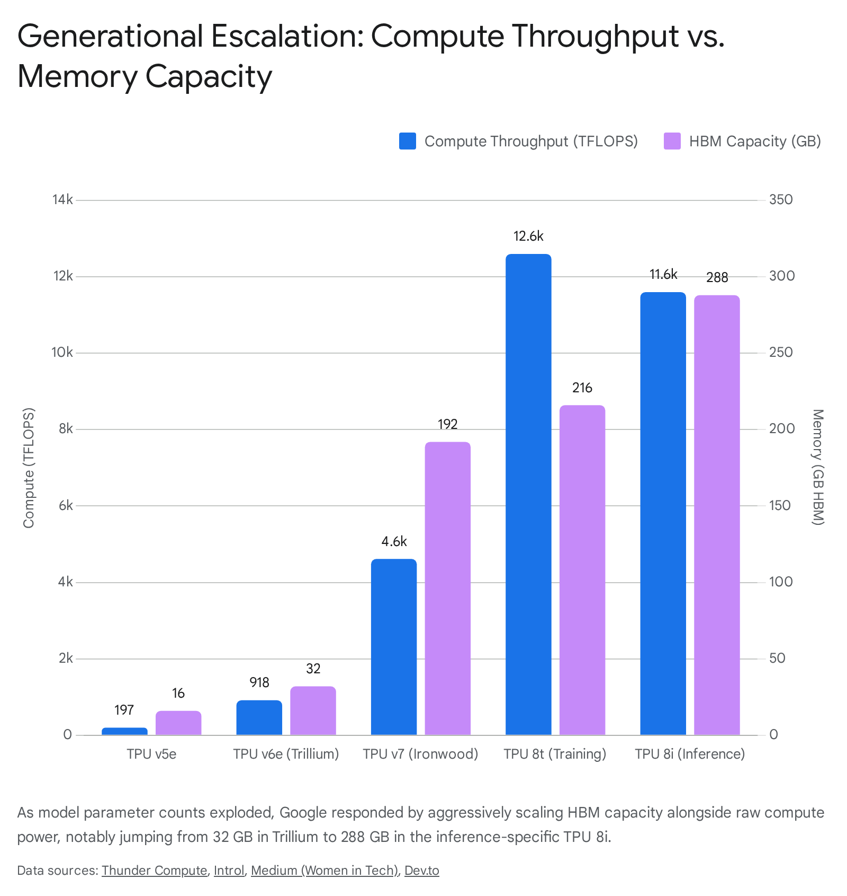
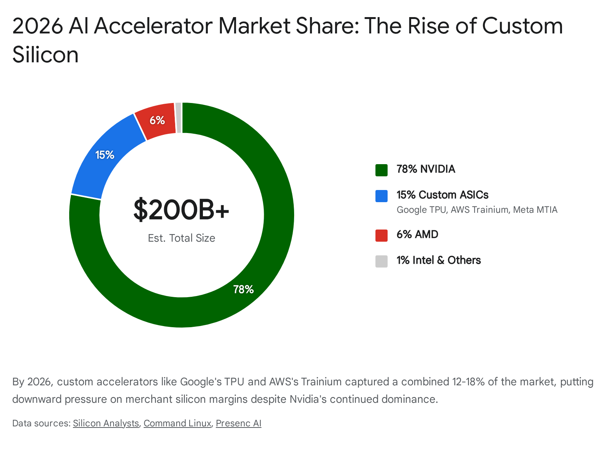

# The Evolution of Google's Tensor Processing Units: From Internal ASIC to Hyperscaler AI Supercomputing Dominance (2015-2026)

## The Catalyst for Custom Silicon (2006–2015)

The trajectory of modern artificial intelligence computing infrastructure was irrevocably altered by a mathematical realization regarding global computation limits. Although Google had explored the concept of an Application-Specific Integrated Circuit (ASIC) for neural networks as early as 2006, the theoretical became an existential operational necessity in 2013 [cite: 1]. Internal projections at Google indicated that if merely three percent of its user base utilized voice search for three minutes a day, the computational demands of the underlying Deep Neural Networks (DNNs) would require the company to double its global data center footprint [cite: 2, 3]. 

The semiconductor industry was encountering the physical limits of Moore’s Law and Dennard Scaling, meaning that traditional general-purpose processors—specifically x86 CPUs—were too power-hungry and computationally inefficient to handle the impending surge in machine learning inference tasks across Search, Ads, Photos, and translation services [cite: 4, 5]. Procuring additional commercial Graphics Processing Units (GPUs) was deemed an insufficient solution for inference at scale due to compounding cost and power consumption constraints [cite: 2, 3]. In response to this impending crisis, a specialized engineering team was assembled, featuring luminaries in computer architecture including Norman P. Jouppi (a principal architect of the MIPS processor) and David Patterson (co-creator of RISC and RAID) [cite: 1, 6, 7]. This team embarked on a high-priority initiative to design a custom ASIC tailored exclusively for deep learning inference [cite: 1, 6].

What typically takes the semiconductor industry several years to achieve was accomplished in a remarkably condensed timeline. Google designed, verified, manufactured, and deployed the first-generation Tensor Processing Unit (TPU) into its data centers in a mere 15-month sprint [cite: 1, 6]. This rapid deployment was characterized by shipping the first silicon with zero bug fixes or mask changes, a testament to the unprecedented talent density of the engineering team assembled during that era [cite: 1, 5].

## The First Generation (TPU v1): Radical Minimalism and the Systolic Array

Deployed internally in 2015 and publicly unveiled at the Google I/O conference in May 2016, the TPU v1 was strictly an inference-only accelerator [cite: 6, 8, 9]. Rather than building a flexible, general-purpose processor, the architectural philosophy of the TPU v1 was rooted in "radical minimalism" [cite: 1, 9]. It intentionally eschewed complex microarchitectural features designed to optimize average-case performance—such as caches, branch prediction, out-of-order execution, multiprocessing, speculative prefetching, and context switching—to focus entirely on deterministic execution [cite: 1, 3]. This deterministic model was crucial for meeting the strict 99th-percentile response-time requirements of consumer-facing neural networks, an area where standard CPUs and GPUs often faltered due to their time-varying optimizations [cite: 3].

The computational heart of the TPU v1 was a massive Matrix Multiply Unit (MXU) utilizing a systolic array architecture. The concept of systolic arrays originated from a 1983 patent application by H.T. Kung and Charles Leiserson, which detailed mathematical architectures for matrix computations [cite: 2, 6]. The TPU v1's systolic array consisted of a 256x256 grid of 8-bit integer (INT8) multiply-accumulate (MAC) units, yielding 65,536 ALUs operating synchronously [cite: 3, 9]. 

The systolic array utilized a weight-stationary dataflow. Weights (model parameters) were loaded and remained fixed in the computational grid, while activation data streamed rhythmically horizontally across the array. Partial sums propagated vertically, eliminating the need to write intermediate values back to memory for the entirety of the matrix multiplication [cite: 3, 9]. Running at a deliberately conservative clock speed of 700 MHz to minimize power draw (operating at a 40W Thermal Design Power), the matrix unit delivered an astonishing 92 Tera-Operations Per Second (TOPS) [cite: 1, 3, 4, 9]. 

To interact with the host system, the TPU v1 was deployed as a PCIe expansion card and relied on DDR3 DRAM for external memory [cite: 4, 9]. It utilized a Complex Instruction Set Computer (CISC) instruction set, where a single MatrixMultiply instruction could invoke hundreds of thousands of operations, vastly differing from the Reduced Instruction Set Computer (RISC) architectures prevalent in standard CPUs [cite: 1].

The seminal 2017 paper, "In-Datacenter Performance Analysis of a Tensor Processing Unit," presented at the 44th International Symposium on Computer Architecture (ISCA 2017), codified the hardware's success. The TPU v1 achieved 15 to 30 times higher performance and 30 to 80 times higher performance-per-watt than contemporary Intel Haswell CPUs and Nvidia K-80 GPUs for production inference workloads [cite: 1, 2, 6]. Initially intended for a small run of roughly 10,000 units, internal demand surged, leading to the deployment of over 100,000 TPU v1 chips to power Google Search ranking, YouTube recommendations, and Google Translate [cite: 9, 10].

## Transition to Training: TPU v2 and v3 (2017–2018)

While TPU v1 revolutionized inference, the training of neural networks remained fundamentally constrained by the limitations of commercial GPUs [cite: 2, 3]. Training NNs is inherently more complex than inference; it requires vast amounts of memory to store intermediate activations during backpropagation, and the weight matrices constantly update rather than remaining static [cite: 2]. Recognizing that training capability was the primary bottleneck to producing better models, Google announced the TPU v2 in May 2017, transforming the TPU from an inference engine into a complete neural network training platform [cite: 6, 8, 9, 10].

### Architectural Shifts: Floating Point and High-Bandwidth Memory
To support the dynamic range required for gradient descent, the TPU v2 abandoned the 256x256 INT8 array in favor of dual 128x128 systolic arrays utilizing a custom floating-point format: bfloat16 [cite: 2, 9]. Bfloat16 maintained the same 8-bit exponent range as standard 32-bit floating-point (FP32), ensuring sufficient dynamic range for training stability, but truncated the mantissa to save die space and power [cite: 9]. 

Furthermore, memory bandwidth had severely bottlenecked previous iterations [cite: 6]. The TPU v2 integrated 16 GB of High Bandwidth Memory (HBM), replacing the slower DDR3 and drastically elevating memory bandwidth to 600 GB/s, pushing per-chip compute to 45 teraFLOPS [cite: 6, 9]. 

### Scaling to the Pod Level and Liquid Cooling (TPU v3)
The TPU v3, introduced in 2018, aggressively scaled the v2 architecture. It doubled the number of TensorCores per chip, pushing per-chip performance to 420 TFLOPS [cite: 8]. Because this intense compute density generated immense thermal output, Google introduced liquid cooling to the data center racks for the first time, allowing the v3 servers to occupy less vertical space [cite: 4, 8]. 

More significantly, these generations marked the beginning of Google's "supercomputer" approach to AI. Chips were networked together into highly synchronized "Pods." A v2 Pod connected 256 chips, yielding 11.5 petaFLOPS of performance [cite: 6]. The v3 scaled this further, linking 1,024 chips via an advanced 2D torus network [cite: 8]. The evolution from the single-chip, inference-only TPU v1 to the massive, liquid-cooled TPU v3 pods established Google's blueprint for distributed AI training infrastructure. The transition from PCIe-attached accelerators to holistic warehouse-scale supercomputers utilizing HBM and bfloat16 precision proved instrumental in managing the growing complexity of machine learning models.

### Cultural Impact: The AlphaGo Milestone
The strategic capability of these specialized arrays was dramatically demonstrated to the public via DeepMind's AlphaGo. In 2016, a version of AlphaGo powered by 48 TPUs defeated 18-time world Go champion Lee Sedol 4-1 in a historic match in Seoul, South Korea, fundamentally collapsing the assumption that the ancient game represented a final, human-only frontier [cite: 11, 12, 13]. 

However, the subsequent iteration, AlphaGo Zero, showcased the exponential hardware efficiency gains. Achieving superhuman performance by learning the game entirely through self-play from scratch, AlphaGo Zero surpassed the Lee Sedol-defeating version by a staggering 100 to 0 margin, while operating on a single machine equipped with just four TPUs [cite: 11, 14]. This event proved that massive parallel matrix multiplication could unlock heuristic intuition previously thought exclusive to the human mind [cite: 12, 13, 15].

## The Exascale Networking Breakthrough (TPU v4 & v5)

As the industry entered the Transformer era, marked by Google's invention of the architecture in 2017 and the subsequent rise of Large Language Models (LLMs) such as BERT, the parameter counts of foundational models began growing exponentially [cite: 16, 17]. The primary constraint shifted from raw compute (FLOPS) to communication bandwidth—how fast networked chips could synchronize gradients during distributed training [cite: 8, 18]. 

### TPU v4: Optical Circuit Switching (OCS)
Deployed internally in 2020 and commercially via Google Cloud in 2021, the TPU v4 (built on a 7nm process) represented a monumental leap in infrastructure [cite: 17, 19]. While compute per chip increased to 275 TFLOPS (bfloat16) and HBM increased to 32 GB, the definitive innovation was the Optical Circuit Switch (OCS) [cite: 7, 9, 20].

The v4 pods abandoned the 2D torus for a 3D torus topology (scaling up to 4,096 chips per pod), utilizing the OCS to dynamically reconfigure the interconnect topology [cite: 7, 9, 20]. Optical Circuit Switches use Micro-Electromechanical Systems (MEMS) mirrors to route optical signals directly without converting them to electrical signals [cite: 9, 20]. This allowed for dynamic reconfiguration in sub-10-nanosecond windows to bypass failed nodes, optimize network topology for specific model shapes, and dynamically slice pods for multi-tenant cloud usage [cite: 9, 21]. Costing less than 5% of the total system cost and consuming less than 3% of the system's power, the OCS was vastly cheaper, lower-power, and more reliable than traditional Infiniband networking fabrics [cite: 7, 20, 21]. 

The v4 also introduced the "SparseCore," a specialized dataflow processor for handling embedding operations. While occupying only 5% of the total die area and power budget, SparseCores accelerated models relying heavily on massive vocabulary embeddings (such as ranking and recommendation systems) by 5x to 7x [cite: 9, 21]. 

This infrastructure proved its worth when Google orchestrated the training of the 540-billion parameter Pathways Language Model (PaLM) in 2022. Using the "Pathways" distributed computing software system, Google bridged two separate 3,072-chip v4 pods [cite: 16, 17]. This setup maintained a staggering 57.8% hardware FLOPs utilization over 50 days of continuous training—an unprecedented level of efficiency at an exascale level [cite: 7, 16, 17].

### TPU v5: The Bifurcation of Workloads (2023)
Recognizing that model training and model serving (inference) require fundamentally different economics and topologies, Google strategically bifurcated the fifth generation in 2023 [cite: 8, 19].

*   **TPU v5e (Efficiency):** A cost-optimized chip featuring 16 GB of HBM2e, utilizing a simpler 2D torus network designed to scale to 256-chip pods. It targeted high-throughput inference and training for sub-frontier models (under 200B parameters) and provided approximately 2.3x better price-performance than the TPU v4 [cite: 8, 22].
*   **TPU v5p (Performance):** A training powerhouse featuring 95 GB of HBM2e (delivering 2,765 GB/s bandwidth), scaling to massive 8,960-chip pods via a 3D torus [cite: 9]. Providing 4,800 Gbps of Inter-Chip Interconnect (ICI) bandwidth per chip, the v5p was instrumental in the foundational training of the Gemini 1.0 architecture (Ultra, Pro, and Nano variants) [cite: 8, 9, 23].

| Specification | TPU v2 (2017) | TPU v3 (2018) | TPU v4 (2021) | TPU v5e (2023) | TPU v5p (2023) |
| :--- | :--- | :--- | :--- | :--- | :--- |
| **Primary Focus** | Training | Scale-Out Training | Exascale Training | Cost-Optimized / Inference | Peak Performance Training |
| **Peak Compute** | 45 TFLOPS | 420 TFLOPS | 275 TFLOPS | 197 TFLOPS | 459 TFLOPS |
| **HBM Capacity** | 16 GB | 32 GB | 32 GB | 16 GB | 95 GB |
| **HBM Bandwidth** | 600 GB/s | 900 GB/s | 1,200 GB/s | 819 GB/s | 2,765 GB/s |
| **Max Pod Scale** | 256 chips | 1,024 chips | 4,096 chips | 256 chips | 8,960 chips |
| **Network Topology**| 2D Torus | 2D Torus | 3D Torus (OCS) | 2D Torus | 3D Torus |

## Architecting the Future: The AlphaChip Revolution

Underpinning the rapid iteration of these TPU generations is a meta-evolutionary narrative: artificial intelligence is now actively designing the next generation of artificial intelligence accelerators. Beginning with the development of the TPU v4, Google DeepMind implemented a deep reinforcement learning (RL) methodology for chip floorplanning, later officially named **AlphaChip** [cite: 24, 25, 26].

Chip floorplanning—the process of arranging millions of macro blocks and standard logic cells on a silicon die to optimize physical area, power consumption, and signal timing—is a complex, intertwined routing problem that had largely defied total automation for sixty years [cite: 24, 25, 27]. Traditional methods relied on painstaking manual engineering or heuristic-driven processes that were prone to inefficiencies and delays [cite: 27]. 

AlphaChip approached floorplanning as a sequential decision-making game, similar to how AlphaGo approached the board game Go. Starting from a blank grid, the AI placed one circuit component at a time, receiving rewards based on the final layout's efficiency metrics, such as total wire length, routing congestion, and adherence to timing limits [cite: 24, 25, 27]. Utilizing an edge-based graph neural network to model the spatial relationships between components, AlphaChip consistently generated superhuman chip layouts in a matter of hours, rather than the weeks or months required by human engineering teams [cite: 24, 25, 27]. 

The operational impact was immense. By the time Google designed the Trillium (v6) architecture, AlphaChip's layouts were instrumental in achieving a 4.7x performance boost and a massive 67% reduction in energy consumption compared to human-designed iterations [cite: 25, 27, 28]. Furthermore, by 2026, AlphaChip had extended its utility beyond TPUs, generating layouts for Google's Axion Arm-based CPUs and being licensed externally to merchant silicon vendors like MediaTek [cite: 24, 25, 29]. This dynamic proved that the AI design feedback loop was radically accelerating the pace of semiconductor advancement, resulting in tens of millions of dollars in potential savings per design cycle [cite: 29].

## The Generative AI Arms Race: Trillium (v6) and Ironwood (v7)

As the generative AI arms race intensified between 2024 and 2025, hyperscalers aggressively condensed their hardware release cycles. Google launched Trillium (TPU v6e) in late 2024 and rapidly followed with Ironwood (TPU v7) in late 2025, aiming to capture the massive influx of LLM training and serving workloads [cite: 19, 30].

### Trillium (TPU v6e): Quadrupling the Matrix
Announced at Google I/O 2024, Trillium represented a step-change in architectural throughput rather than an incremental gain. Instead of the traditional 128x128 MXU utilized from v2 through v5p, Trillium integrated a massive 256x256 systolic array, generating 65,536 operations per clock cycle per core [cite: 8, 31]. 

This structural expansion delivered a 4.7x peak compute performance increase over the v5e, achieving 918 BF16 TFLOPS [cite: 22, 30, 31]. Memory capacity doubled to 32 GB HBM (providing 1.6 TB/s memory bandwidth), and ICI bandwidth hit 3.2 Tbps per chip [cite: 8, 30, 31]. Despite this raw power output (operating at an estimated 300W TDP, roughly half of Nvidia's H100), the chip achieved a 67% improvement in energy efficiency [cite: 8, 30, 31]. Trillium pods scaled to 256 chips, and via multislice Jupiter network fabrics, could connect up to 100,000 chips for massive distributed training jobs, proving highly effective for models like Gemini 1.5 Flash, Imagen 3, and Gemma 2 [cite: 30, 32]. For dense LLMs like Llama2-70b, Trillium offered a 2.1x increase in performance per dollar over Cloud TPU v5e [cite: 32].

### Ironwood (TPU v7): The Frontier Supercomputer
Released in late 2025, Ironwood (TPU v7) was engineered specifically for the "Age of Inference" and frontier model training [cite: 19, 22, 33]. Ironwood abandoned the single monolithic die in favor of a dual-chiplet design connected via a high-speed die-to-die interface, housing two TensorCores and four SparseCores per assembly [cite: 26].

The specifications represented a sheer brute-force escalation of capabilities:
*   **Performance:** 4,614 TFLOPS per chip, utilizing native FP8 precision for the first time [cite: 8, 26, 31].
*   **Memory:** 192 GB of bleeding-edge HBM3e, offering 7.37 TB/s of bandwidth to alleviate the "memory wall" inherent in serving LLMs [cite: 8, 31].
*   **Networking:** 9.6 Tbps ICI bandwidth per chip (1.2 TB/s bidirectional), arranged in massive 3D torus superpods of 9,216 chips, delivering an astronomical 42.5 ExaFLOPS at FP8 precision [cite: 9, 26, 31].

Ironwood served as the underlying engine for Google's Gemini 2.5 and Gemini 3.0 models. Unlike the broader industry standard where Nvidia GPUs dominated foundational training, Google successfully trained Gemini 2.5 Pro entirely on TPU v6 and v7 infrastructure, proving that a completely vertically integrated stack—avoiding merchant silicon entirely—could yield state-of-the-art multimodal reasoning [cite: 33, 34, 35].

## The Agentic Era and Network Flattening: TPU 8t and 8i (2026)

By 2026, the nature of artificial intelligence interaction had transitioned from isolated, single-turn chat queries to "agentic workflows." In this paradigm, autonomous models decompose overarching goals into specific tasks, spawn specialized sub-agents, preserve state, and continuously stream reasoning tokens in real-time using reinforcement learning [cite: 36]. Furthermore, the dominance of Mixture-of-Experts (MoE) architectures drastically altered compute patterns. MoE inference is severely memory-bandwidth bound rather than compute-bound; the accelerator serving tokens must stream vast amounts of weights and manage immense Key-Value (KV) caches rapidly across the cluster [cite: 8]. 

To address these highly specific constraints, Google launched its eighth generation at Google Cloud Next 2026, formally splitting the architecture into two distinct physical silicon tracks co-designed with Broadcom and Google DeepMind, both built on the TSMC N3 process and hosted on Google's Axion ARM-based CPUs: the TPU 8t for training and the TPU 8i for inference [cite: 8, 31, 37].

### TPU 8t: The Massive Scale-Out Architecture
The TPU 8t was engineered for massive-scale pre-training. Introducing native 4-bit floating point (FP4) support, it squeezed more parameters into local memory buffers, essentially doubling MXU throughput by minimizing energy-intensive data movement without degrading accuracy [cite: 38]. The 8t delivered 12.6 PFLOPS of FP4 compute per chip, alongside 216 GB of HBM3e (providing 6,528 GB/s bandwidth) [cite: 31].

The most profound shift, however, was the **Virgo Network**. Recognizing that the ultimate system constraint for LLMs had shifted from chip-level compute to data center network (DCN) bandwidth, Virgo utilized high-radix switches in a flat, two-layer non-blocking topology [cite: 18, 38]. While a single superpod contained 9,600 chips (delivering 121 ExaFLOPS and 2 PB of shared HBM), a single Virgo fabric could connect over 134,000 TPUs in one data center, effectively transforming globally distributed infrastructure into one seamless, non-blocking supercomputer [cite: 8, 18, 31, 36].

### TPU 8i: The Boardfly Inference Engine
The TPU 8i, conversely, focused intensely on post-training and low-latency inference. Each chip was loaded with 288 GB of HBM (surpassing the training variant) and an unprecedented 384 MB of on-chip SRAM to hold larger layers immediately adjacent to the compute cores [cite: 8].

Because agentic MoE routing requires rapid all-to-all communication across the pod to select the appropriate "expert" network, standard 3D torus networks (which require packets to traverse up to 16 hops) were too slow, introducing severe tail latency that crippled token streaming [cite: 39]. Google engineered the **Boardfly** interconnect—a hierarchical, high-radix network inspired by Dragonfly topologies designed to violently flatten the architecture [cite: 18, 39]. 

In the Boardfly topology, 4 chips form a fully connected block; 8 blocks connect via direct copper cabling; and 36 groups connect via long-haul Optical Circuit Switches into a 1,152-chip pod [cite: 39]. This collapsed the maximum network diameter from 16 hops down to just 7 hops, slashing inference latency by 50% [cite: 8, 37, 39]. Combined with the new Collectives Acceleration Engine (CAE)—which replaced the SparseCores to offload global operations and cut latency by 5x—the TPU 8i delivered 80% better performance-per-dollar for inference workloads compared to Ironwood [cite: 8, 37].

| Specification | TPU v6e (Trillium) | TPU v7 (Ironwood) | TPU 8t (Training) | TPU 8i (Inference) |
| :--- | :--- | :--- | :--- | :--- |
| **Release Year** | 2024 | 2025 | 2026 | 2026 |
| **Compute Power** | 918 TFLOPS (BF16) | 4,614 TFLOPS (FP8) | 12.6 PFLOPS (FP4) | 11.6 ExaFLOPS per pod (FP8) |
| **HBM Capacity** | 32 GB | 192 GB | 216 GB | 288 GB |
| **Memory Bandwidth**| 1.6 TB/s | 7.37 TB/s | 6,528 GB/s | Not Disclosed |
| **Network Fabric** | 2D Torus | 3D Torus | Virgo Network | Boardfly Topology |
| **Max Scale** | 256 chips/pod | 9,216 chips/superpod | 134,000+ chips/fabric | 1,152 chips/pod |

## Democratizing the Ecosystem: Software Moats and Model Benchmarks

The physical hardware represented only one half of the AI infrastructure equation. Historically, Nvidia's absolute market dominance (peaking near 90% market share) was heavily defended by its CUDA software ecosystem, which locked developers into its hardware through ubiquitous tools and libraries [cite: 35, 40, 41]. Google’s TPU ecosystem historically relied on TensorFlow and JAX, utilizing the XLA (Accelerated Linear Algebra) compiler. While highly efficient for internal hyperscale workloads and declarative model descriptions, the lack of native, imperative PyTorch support alienated the broader open-source developer community [cite: 30, 42, 43].

### TorchTPU: Breaching the CUDA Moat
In October 2026, Google executed a vital strategic maneuver by open-sourcing **TorchTPU**, developed in direct collaboration with Meta’s PyTorch team [cite: 42, 44, 45]. Announced at the PyTorch 2026 Conference, TorchTPU introduced a native, principled PyTorch backend for Google TPUs [cite: 43]. 

Previously, developers using PyTorch on TPUs had to route through the intrusive PyTorch/XLA layer, which suffered from severe compilation latency, lacked support for native imperative ("eager") execution mode, and lagged in supporting distributed computing primitives [cite: 42, 43]. TorchTPU eliminated these barriers. It allowed developers to debug using eager mode and compile for production optimization, requiring only a single device string change (`model.to("tpu")` or `device_map="tpu"`) to migrate models from GPUs to TPUs seamlessly [cite: 44, 45, 46]. By supporting major frameworks like Hugging Face, vLLM, SGLang, and Ray natively, TorchTPU represented a direct assault on the CUDA moat, drastically lowering the switching costs for enterprises looking to escape Nvidia's pricing premiums [cite: 19, 40, 46]. 

This software democratization paired exceptionally well with the raw benchmarking data TPUs were generating. Cloud TPUs demonstrated severe competitive advantages across a variety of architectures:
*   **Large Language Models (GPT-3/BERT):** Google’s TPU v4 pods completed BERT pre-training in 0.39 minutes compared to 0.69-0.81 minutes for comparable GPU systems, and demonstrated 1.8x to 2.3x faster training iterations for GPT-3 scale models versus equivalent DGX-A100 server clusters [cite: 47].
*   **Natural Language Processing (RoBERTa):** Training RoBERTa exhibited a 1.9x speedup on TPU v4-128 pods compared to an 8-node DGX-A100 cluster, reducing pre-training times from a week to 3-4 days [cite: 47].
*   **Computer Vision (ResNet-50):** TPUs processed 8,127 images/second compared to 4,780 images/second on Nvidia A100s, yielding a 1.7x training speed advantage alongside near-linear 94% scaling efficiency [cite: 47].

Furthermore, Google streamlined infrastructure orchestration. By June 2026, Google Kubernetes Engine (GKE) fully supported TPU nodes, automating resource provisioning, scaling, scheduling, and repairing for AI workloads, seamlessly integrating TPUs into standard enterprise DevOps pipelines [cite: 48].

## The Edge TPU: Localized Inference and the RISC-V Pivot

While Cloud TPUs managed massive data center training and serving workloads, Google also maintained a strategic presence in localized, low-power inference via the **Coral Edge TPU**.

### The Original Edge TPU Architecture
Introduced in 2018 and gaining widespread adoption by 2019, the original Google Edge TPU was a purpose-built ASIC designed to bring high-accuracy machine learning inference to edge computing devices [cite: 6, 49, 50]. The hardware was celebrated for its extreme performance-per-watt metric; it delivered 4 TOPS of inference performance while operating within a stringent 2-watt thermal envelope (0.5 watts per TOPS) [cite: 51, 52, 53]. 

The Edge TPU was strictly an inference coprocessor, incompatible with general training tasks [cite: 54]. It achieved its efficiency through post-training quantization, requiring models to be converted to TensorFlow Lite and strictly quantized to 8-bit integers (INT8) [cite: 51, 53, 54]. This aggressive quantization shrank model sizes and memory bandwidth requirements, allowing the ASIC to operate efficiently in fanless environments [cite: 53]. 

However, as deploying edge AI grew more complex by 2026, legacy Edge TPU hardware (such as the Dual Edge TPU M.2 Key E cards) encountered severe integration roadblocks. The dual-core modules lacked onboard PCIe switch chips to maintain a $40 price point, relying instead on direct wiring to PCIe Lane 0 and Lane 1 [cite: 52]. When plugged into standard M.2 Key M storage slots on modern motherboards, the host system often failed to recognize the second core due to PCIe bifurcation incompatibilities, compounded by the need for custom Gasket kernel drivers on modern Linux kernels (Debian 12 / Kernel 6.8+) [cite: 52]. Furthermore, thermal management was aggressive; at an 85°C junction temperature, the driver initiated duty-cycle throttling, artificially inserting idle wait states to cool the silicon [cite: 52].

### The 2026 Pivot: Coral NPU and Open RISC-V Standards
Recognizing the limitations of selling proprietary, localized hardware that struggled with integration, Google executed a profound pivot in late 2025 and 2026. Rather than continuing to manufacture proprietary Google-branded Edge TPUs, Google Research open-sourced the underlying neural processing unit architecture, rebranding it as the **Coral NPU** [cite: 51, 55].

The Coral NPU was an end-to-end, open-source stack based entirely on RISC-V standards, featuring a RISC-V 32-bit ISA 4-stage CPU, a RISC-V RVV vector execution unit, and dedicated quantized outer-product multiply-accumulators (MACs) [cite: 51, 56]. By licensing this IP, Google allowed third-party semiconductor companies to embed the Coral NPU directly into their own system-on-chips [cite: 51, 55]. 

In October 2026, Synaptics became the first major partner to launch shipping silicon based on this open standard, introducing the Astra SR200 series and the Coralboard SL development board [cite: 51, 55]. Priced at $99.79, the Coralboard SL featured a 1 TOPS Coral NPU alongside ARM Cortex-A55 cores, demonstrating Google's shift from hardware vendor to ecosystem orchestrator at the edge, perfectly complementing their hyperscale Cloud TPU dominance [cite: 51, 55].

| Feature | Original Edge TPU (2018-2025) | Coral NPU (2026 Onward) |
| :--- | :--- | :--- |
| **Hardware Strategy** | Proprietary ASIC manufactured by Google | Open-source IP licensed to third-party vendors |
| **Instruction Set** | Custom Google Architecture | RISC-V standard compliant (Scalar & Vector units) |
| **Performance Profile** | 4 TOPS at 2W (INT8) | Configurable up to 1 TOPS at ~10mW average power |
| **Form Factors** | USB Accelerator, M.2, Mini PCIe, Dev Board | Integrated directly into partner SoCs (e.g., Synaptics Astra SR200) |
| **Software Framework** | Strict TensorFlow Lite (INT8 only) | Google Coral MLIR compiler (JAX, PyTorch, LiteRT support) |

## The Hyperscaler Battleground and Market Dynamics (2026)

By the end of 2026, the artificial intelligence accelerator market exceeded $200 billion annually [cite: 57]. While Nvidia's absolute revenue in data centers surged past $150 billion, its total market share experienced a noticeable and permanent contraction, sliding from a peak of 87% in 2024 to approximately 75–81% [cite: 41, 57, 58]. This percentage decline was not due to a failure in Nvidia's product pipeline (as the Blackwell B200 and Rubin architectures remained highly coveted), but rather the rapid and aggressive scaling of "Captive Silicon"—custom chips built by hyperscalers for internal and cloud-tenant workloads [cite: 41, 57, 59, 60].

The year 2026 witnessed the "Inference Inversion," a historic tipping point where the volume of compute deployed for serving live models (generating tokens via inference) surpassed the compute used for initial model pre-training [cite: 58]. Because inference at a global scale requires supreme energy efficiency and low latency to maintain profitability, custom ASICs like the Google TPU 8i, AWS Trainium 3, and Microsoft Maia 200 offered a 40% to 65% Total Cost of Ownership (TCO) advantage over general-purpose merchant GPUs [cite: 58]. 

However, unlike Nvidia GPUs which are available across all cloud providers, hyperscaler silicon enforces strict single-vendor lock-in. AWS Trainium 3 relies on the Neuron SDK, locking workloads to AWS EC2; Azure's Maia 200 is entirely captive with no independent rental option; and Google's TPU requires JAX or TorchTPU, carrying single-vendor lock-in to Google Cloud Platform (GCP) [cite: 59, 61]. Despite this lock-in, the economic benefits of TPUs drove massive enterprise adoption.

Google capitalized on this TCO advantage to court massive enterprise clients, effectively transitioning the TPU from a strictly internal advantage into a commercial utility capable of attracting the world's leading AI labs away from Nvidia. Most notably, Anthropic committed to an infrastructure agreement worth over $450 billion across a 7-to-10-year span, effectively securing up to 1 GW of dedicated TPU capacity (translating to approximately one million TPUs, including v7 Ironwood arrays) [cite: 22, 33, 45]. Simultaneously, Meta entered into advanced negotiations for a multi-billion dollar TPU leasing agreement, further validating the architecture for frontier-model intensity [cite: 22, 62]. These massive shifts in capital allocation led prominent industry analysts to project that Google’s parent company, Alphabet, could overtake Nvidia to become the world's most valuable company by market capitalization by the end of 2026, driven by the vertically integrated strength of its AI platform [cite: 63].

## Conclusion

The history of Google's Tensor Processing Units is a masterclass in full-stack vertical integration. What began in 2013 as a desperate engineering sprint to prevent voice search workloads from bankrupting Google's data center capacity has evolved into the most formidable custom silicon ecosystem in the world. 

By fundamentally redefining the architecture of compute at every level—from replacing the traditional Von Neumann bottleneck with systolic arrays in 2015, to implementing Optical Circuit Switching in 2021, and utilizing AI-driven floorplanning via AlphaChip to design the chips themselves—Google has consistently stayed ahead of the exponential compute demands of modern artificial intelligence. With the 2026 bifurcation into the TPU 8t training behemoth and the TPU 8i inference engine, alongside the open-sourcing of TorchTPU and the Coral NPU, Google has successfully breached Nvidia's hardware and software moats. The TPU is no longer just Google's internal secret weapon; it is the foundational supercomputing utility driving the agentic era of artificial intelligence.

**Sources:**
1. [google.com](https://vertexaisearch.cloud.google.com/grounding-api-redirect/AUZIYQFRN0AemIHZtn3MW5hE1NL9Cc0EY8dOMP1TucmllXLYkP6ACbgHan1rDP-7deOlf4Kiz29ABB1X6_0Gcnt2HCMMjVUqKypMzX75DSa5rBFKM72t1ugYzOoBk8MIkjkcav-5WqoJQErNGKT1PlDBw-LsA8XhXB_IvZmGM9yhiA7pWv6k0zBSCZaeO370H5Vh0x0PF_nwpbZvBrq8bbiUKPLvxcd1_7OY07Zaw7l2)
2. [medium.com](https://vertexaisearch.cloud.google.com/grounding-api-redirect/AUZIYQGXTTDYOE9wznQ-6bYZ1siQmj73632OYw5Fat3nJn67yb8228G9HK_FsP_3w5qC7Q550iJaItXvLjaLFQFf-MVPlf89ek-QYH33ldc5D53qZQGUNbD_sLTkCWsoxxkPBfUSQTdA1GiM1u5MZPQayC-7Punx7WtB172CXFvsj3HFeLUvHPRou9R9mP40FUWzqSw9khTg80M=)
3. [arxiv.org](https://vertexaisearch.cloud.google.com/grounding-api-redirect/AUZIYQFD7zdT-iArCmQRro9O8A2zlTdFefDD8vnZEyxCTs-37N7RPSgz6i8Hd6bm_m8u1CC9bamYVxIIKatRFUNYtuDQOwFFZBkCk2GTTtQbqzNCOARRJ6Jo)
4. [ijrar.org](https://vertexaisearch.cloud.google.com/grounding-api-redirect/AUZIYQH-lrJsqOsMqPqG4EoTtqdmc3c472yN_LbpkbFeEYZoFrQEDT5T_n8_HADsj4beaKwNJZbcLKH1RLeVkAiYWJcVw3agOquGZ1VGpYefRLWcVdldg8RiEuzUVlsMJBZCo3HtEQ==)
5. [substack.com](https://vertexaisearch.cloud.google.com/grounding-api-redirect/AUZIYQEmYPf2vFPh2SRx1aEiw01jrR981PPd3oMdS47MiOFoWxCmvgEIZMf5BFKKxo4Xh_7Oe6uPrzHQVVqTxx7Gugd7s5LPx61o71KF_MzopBnij6k91e2YsY0dtPrIxesvnSbbqWBAu8Jeofrza_6uEl1XgVwSBnGV)
6. [wikipedia.org](https://vertexaisearch.cloud.google.com/grounding-api-redirect/AUZIYQEmkvzSYTta2MEu11t6OvVMJGUbDNvv2pg6SLAVqQrGR4SAAk5jIuB4H5PkpBtnKmqnv0nW7I5icJzgWySWIwGjvyEvJYcYUB7fhTmkeEOTf2cBQSCzO7IU7IB2pKMpiRDJLf-auLKpH4A=)
7. [google.com](https://vertexaisearch.cloud.google.com/grounding-api-redirect/AUZIYQEekxATCTBXR6z6MCFhXpto2l2wKjNemhSmch630bziHj2_glxbr5c-DY5uPZKe7pYoBl345NltwP6VeKeDRaYhel9IdQMyHkEAPCzHHNrOp3RMU1PSPm6PYk3fua2qIWkXk9_kjq22DxNYt4oSHjljBKGAZRqMjmAOb52hIBYpe1K6MTOJupYOlScgCN2ZCFyNAUOUKj93vTRu_Q0S)
8. [medium.com](https://vertexaisearch.cloud.google.com/grounding-api-redirect/AUZIYQGrO2DPePf9Y2TtFi3OMe_ALuQmSNHZNhM5vd8UIfe7B6GxWPHehy5Ln-butWFBt0IhXhS5MAxd9Goxbsl7KJlhvXFRjn11J6x8ljYahoC_J7hAKeOSZZJjQ7kwnuPCCknyOFYZCysBq5bqCyZVruQ_sVouOi_LCES7BvecTW2fljSbygbNR03aPtu1PMwO4jeA_LJtzTmf-knDCwGxu9X7y6MnwUfkHMeQrqKffypB_hOZevze9uqSxQ==)
9. [introl.com](https://vertexaisearch.cloud.google.com/grounding-api-redirect/AUZIYQHl5jK_0A8FoGpBQ8_Cbmz9ns0DV0nyjKFEMRP6LhH4yYW3G6oP4u8YC7XUU_xjoQhPzYeV87E1ctqFkOFOnXpd_F_BLpSBDGNN8yJxpq6cUrvHok9RQDIFk_AAk2mP-o-4EH1O9lxK5WYYbkYxkpezc7gtt5RmfBVfvTqcqaGT4-0=)
10. [google.com](https://vertexaisearch.cloud.google.com/grounding-api-redirect/AUZIYQHahHS4zYnr5s2y89TdNGnJxdTTlUT08kvr2Wiya6GOexH2CiibplxfBYSJvTOjutAI9nEg9wUZq5Q7wbyu3wdlJC08p12QhooxdG3V_lGE6IuMYz0jzjBj8piJdT33Ry4AEBX8SsTbqJmfZqvqUUoyUSqWFnETgGfNxQxbrW4A)
11. [firecrux.com](https://vertexaisearch.cloud.google.com/grounding-api-redirect/AUZIYQGa-53ZJMNB8qgt6dbx-zlC-food6owUR01bxPSzI0aw9PKqbehaZqBzkNbGiLa3bT6hMJVA9ieu62pSCtR2HgyE-n3szh-10X0FvDBmRQlJaWTl0Y2mMMQTYfGYANxRyCRemz6iEYd)
12. [wikipedia.org](https://vertexaisearch.cloud.google.com/grounding-api-redirect/AUZIYQE-2oANwjm-u87r0e_Y8K3r-Tzck6xlkIbZLW_G7Ye7S9i8ENam0B0kSf7U1TihQiCk1OCdEmMbkFdGjUrsjz382oqW5jMTUuhpzM9u8mqtvgRwZDwn6LPv6s5AInvp0k-DMkJkyktYQumXyQ==)
13. [gomagic.org](https://vertexaisearch.cloud.google.com/grounding-api-redirect/AUZIYQF3kGI5RKgKSewaWeZYdfpSQrGbM81XMHeao9Wq7lAjHv5ReXFg1DV9LAsjSRxOf5aI88zFynsU5gzDTpg9XoAhnO_HunANRwI8qz8uLc9zxmGGvecds0QJ7BumLgEUY8yuWzZN_iRFKQduVTJ7_4i_C4ynR1-N_0vjXW1yI9neBw==)
14. [deepmind.google](https://vertexaisearch.cloud.google.com/grounding-api-redirect/AUZIYQE--_Dw-qiTqHj8pwPSi2gY-fV4GErKjGVKEWvs7gBYKalzWF0RkNpEdpDZsnIHz0155mQFjIzpe7tYHLJDGBndwGwkELWfwcvgLY08Z-p8ghD2NSZEAMer9__7BRufByoFEPoUhuYAKpTxoRQ45zlgdk0ENs0=)
15. [ark-invest.com](https://vertexaisearch.cloud.google.com/grounding-api-redirect/AUZIYQEpwIb5fLhOTgyNW6LL2t71I63QeJN3EAjUYOCCOMzDlybyP8fiVAzMEoT1osg9S43a-lzyBrNTLZHDp8YRt2rY4KQII2Uhxn2yN7L696_xqlkGEsneC8UuKU_24Bt8g1hukCqQP2bpw1Sx4jvIiicMabK5IKIif4jLKk4Bn0h1D0Uqeg==)
16. [medium.com](https://vertexaisearch.cloud.google.com/grounding-api-redirect/AUZIYQFaqFkU4mjoHexHfZFAmzUP4YA1uO4n2EXbbZOFyH4lqHLXrFZ8SlDxoQc7NrdlmH9K8z0PT7hZEEgHQywwh0SAsTDqtv4zO2PAmUzSWZ4Kg8SMzpfcOm3-2HWbReeRoEFo-tSZHmWHES_MNHuOGYyON46hdOwAop0usYz4RdD4WC2WalYNeT8uA30pX5-EvukVY4oZiuoPllRinryQewJZGWSgtZ9ijXNwGlwf)
17. [uplatz.com](https://vertexaisearch.cloud.google.com/grounding-api-redirect/AUZIYQGEEKWIbl5RM2409OyMBDohPZgRclnPD1qlWXVcZFgZzb8jasS7Fy5bex0QaxEyi0EysuJXHSOKqM6tja99a6V63SnC_qMKSAlJw3PSgA7400hMow3Q6Is9Hzt-R7X5bZgexWFweuurW1Ea-Dh3arriEmUd6cWfmP_wD08Z71pkD2DEInpAF3yQwY4s_9TwKRnEDQYYkRDnwGTRVq_lFhFEGE0fM30=)
18. [substack.com](https://vertexaisearch.cloud.google.com/grounding-api-redirect/AUZIYQF-557dR015XV-ybFkM_rcrdKxsu3iZGCbGyGlAGope5y5vqIrI61VIIoKasJcF7vwugYdTZ_Kqyg5SZnrA86hAaKbsHm7AF2cGTmGQnyot4hMuwPj18aciXcmXPDWnLZjej8_IB3wEC2wE-JO3H3K4qFNfksGT)
19. [github.com](https://vertexaisearch.cloud.google.com/grounding-api-redirect/AUZIYQE0M9pBo_8N0dckCeJJLq_Cetib1cZeO7JAchBNY-NdR3tyturD3wDIUuWERTVbYTpJje2tEwT7ODaktcn13H37fgm28VfdzaR3n_qf9cbcO5Z3epnaVfGhv4UXJTCVFsstdJq1TD1cG9Z6ZeezkmBP2CASYHEoOqg=)
20. [elprocus.com](https://vertexaisearch.cloud.google.com/grounding-api-redirect/AUZIYQFvREnLu1d_XDCMWckmtMFca3oVVO2xBYYqiqjZ8bCGT5Dv6qMjoZ5W0dkPdsfNBOIC7OLDh8_KRTWj0IfUZ-a89icqN0kEbVzHthNvw5BzeZBws09iMKMoP7lfBg==)
21. [semiengineering.com](https://vertexaisearch.cloud.google.com/grounding-api-redirect/AUZIYQHJpJY29_a_Fil1GVIk3GPP3hzWSz9Ij5cQxdbpy87d6FXPAfCHzDWEmm0jV3x78WluYiDGtewdgch2_2U8rYuZvxzV3103gFLMvqO-jSrIVoFlerX9Rc-fex6Ox6HK5mBOHb5x8WF9057g27-9-LqwdLmT-GfyRwwEGZy-tw==)
22. [datacenterfrontier.com](https://vertexaisearch.cloud.google.com/grounding-api-redirect/AUZIYQE_CKIgtck2TrZWdyv2AwwFshgNrGG-pCr6_xCZZQ1EBKDxKyK1D73QIawEGlSwiQP4BhjqHolH0xw93hfgrhpVXeWWWjXytXCIIyk_IyCY1PD9JzPuK0cMSPArohK5l17Syoe_UhrF6pzOfgapA7BMn315_N5IrFwdwesv35Ct9mO-uu9ewoU6QUsip0hW8cc_26Cv-PiJsuSCeU1cUW_aFf2blrYyLXT3QIZ0zmfNP3wG_LwwDWerhDNvwEk6PVD2)
23. [blog.google](https://vertexaisearch.cloud.google.com/grounding-api-redirect/AUZIYQF7WLPAAIRhfpX0Kv8hsN4cgv6iAekZK_L7TDHvMwkr2Y_2L-dsD76UHv5Jm29WuJLCQA68miVXR7ux3lA0mIYltVKwHdWTxCZCOkcr3Vd3SqZiDUZpHfRUnUx2fzcGHhGHCBlQ_Niro8sIxM7BxwB3MU1eUX01kJOZm6c=)
24. [deepmind.google](https://vertexaisearch.cloud.google.com/grounding-api-redirect/AUZIYQEyK2q_25bvndXfsSffPYAgiDzE3GRSxJEd17gR6T8f-bMcPafC3IoxHDvQLKtVqjVMmWadlbpeQ5HjKMlrHNWKwbiR6mpDy1neHwKa-RDYtaAZpHuvmZjTCwfaVLqQv6NO5i2uV0eNW198PBppSXfBNUS-HuDeCSE8Jgzh_apRPA4=)
25. [firstmovers.ai](https://vertexaisearch.cloud.google.com/grounding-api-redirect/AUZIYQFzpLmfy9AqCTHY4fzW4UEa0S_ektdqTiXnTg1fmOkGjvdKhWPq_eaY_hq1COMbCCfOLhGFEPCVbI3RRixXuLLV5ATDHgkEe7kQK5qztN8oBbFMvbX28b5JYf-oF61v)
26. [dev.to](https://vertexaisearch.cloud.google.com/grounding-api-redirect/AUZIYQGg0HbP4ZTdEW6Emv-anyilQPZVxpeSlLxlJxNXD0VwfAx9CzGhvjJ56PzWEJmCh-lLmWEwmYFyLE_qxZTrpscRJdjQ_im-BU63cyuYxGG3hXKGOlAXem3Y6JUKGAViggt-JlrpIHfCuE0AzGRJGMm4JJ8ryDJAsJJBJU95PDUOc-hMZvxAkP7XaGoyvaNsbTBm3uC6yU0QUDUMOGQ8kSbq)
27. [medium.com](https://vertexaisearch.cloud.google.com/grounding-api-redirect/AUZIYQFxPZKz_xSJAD6naGCYZN152X8VC2VPz2lvbXOLcdGfx4CNjBQKBYDRw5FTbijAXafQ0_nzu57RyqTqlc7Fum1yw7a4JgClGxHpLKmY1mnebUqBJz7-1AFbjmOa74PJKelTV-j5MW8j0UpkLn5CNBraadnZzzHPGwtbiT5q)
28. [unite.ai](https://vertexaisearch.cloud.google.com/grounding-api-redirect/AUZIYQEeNXAEDbF0QiY4TbwrLmxGhuM-oP4X5J8IKutZ8czqzgPS2AEG6nBlZczi4KJ_Yjr9RjApLwZTbItz-Ousd732y_9zSWox3ki6hrWRt8lwL4gFK9D4DQgJi1j-077PUPrWAS5wrL0Kw4kSCPuXKpX7RAxDxvQyGosI88McKCvw2q3yDg==)
29. [medium.com](https://vertexaisearch.cloud.google.com/grounding-api-redirect/AUZIYQHRFKguHnMHPzqZiUdhJwKlNFUupAQmUDHHukmS4emNCkkpGFCFR3_9n6adUyPGW2B5QRqbn6ocvT7unfAHFx40jk0ANmDcnowt2wG5WvF8GfZMlxke4cS3RsollVhAlejBttXRDprySgjTNvpJ5ZUzWPimZ7tFl-P9MP8pj7xXw7UpDlEm_Spogu_3JbIl4_1X_Tpx14EeSxhwqNC5s8Jf6Rc1b2d4O0YLAS676b8V1n51j6_BebRS)
30. [google.com](https://vertexaisearch.cloud.google.com/grounding-api-redirect/AUZIYQENjob3AUcI3OpJMiHpOcLnhCAKG0cMf7QzH4khoEj52VCx91ArPJR5_hONTHx3xKrru3QKO7zpQkdRWhmSCpCztkHFKGIaMI-raW3UFhTKNcAf3XEG8RSIRuykLLNto5nsy9YkdYAnU_PNcbadoqNWoNSEEI1wWNRTRQRLpveZQ9HpE4bA)
31. [thundercompute.com](https://vertexaisearch.cloud.google.com/grounding-api-redirect/AUZIYQEoyHkID-TwHQMH24PNMxwKqUqCj2H-kFSXR8j_2asJQ7hzQnYmNQime-LlT68gh6dCPQiTEWiGGe7rzZSuPGTrSf6eJTCZBuzqCc5wkv5ItOiC7jrtb7SEDVf6jWdzbmRxFEr02tiNZ6qU)
32. [google.com](https://vertexaisearch.cloud.google.com/grounding-api-redirect/AUZIYQEg-N9z6_1SvwX6nE5XIlKibuj5_vaCNiLZMlSPua8YU9s0_m4bzLFHuN6jPOTIuVBqDj3W1DqKZDE764i7f-OUrxa9zmxzg3oWuVqr6aTw1xw0_Yn9sRFtermqI-RY8Fd_vtu4fJavCV4f3XHkqy7EQdTEMVB3)
33. [labo-llm.fr](https://vertexaisearch.cloud.google.com/grounding-api-redirect/AUZIYQFM6vdne-5On0YU01UWkLWeuSn6s3hYy3mkqevjDeXQUtQFgiH7NGenlen62iRzVnVgWete9ny1RsjL4XclDLwPZuu6hTkEAFCQa3LDTL6qKGQK7w632aKbGYa2rUMbW6DT-rF9PaEXeS6DLQ==)
34. [vincentschmalbach.com](https://vertexaisearch.cloud.google.com/grounding-api-redirect/AUZIYQFVU85rcc4nDdtlq5rAIfRgRjgOQaqC2lJGf9-H0jNtgb3K3Mxy6VKQUHLJiinBfSV55j60AFoBRe14D59YGNPVq7a-HobqS0q7mmLvV5o66FPhqHk1-1dXAdUovH1Qe37wXKDTmrNDzhWptSsD17sTGADkfa3JUgt5kKgNj8CSYkHBP9g=)
35. [reddit.com](https://vertexaisearch.cloud.google.com/grounding-api-redirect/AUZIYQGkWLYTu8mpSdiuGzai_wj577S0EVuMWUemdeCaBZa2lzN450MJrh6ix6km9z3O4T7Jdq8mqo743K-Ni72vjyO02ubup335eaFHQM3UADXOswur-LUmec6eCmaKQ2NHWdLT6GuwmtT2CJ7PXN9E9DlaGsRXrLvnD9Ug4SinpBOhwU5abqIWG4FUEL1Rqmiqu99vNu8O1Egyt3nzJHG6yklxNA==)
36. [google.com](https://vertexaisearch.cloud.google.com/grounding-api-redirect/AUZIYQELjJ8yArvXv70LLf_kbTJ0zwe22w-9NXyXffpgbdAUxGMuV_iIx-tgZMygucnd8CiOuvZnDkIOu4K9xb_gZWZ8lLcqS6nAINUAme4ssflbced1jp4icLSDAgsb9hBcmTbdeVBmNZnnOJ81ruB3lxoE9LcBqsuxtrdAJ7T0nJgs)
37. [blog.google](https://vertexaisearch.cloud.google.com/grounding-api-redirect/AUZIYQFr-2tLgYz4DLYEC4o2WNW8OtW21KZdBksmMkh3ddbNPaYLM1gqS4ITyGm0pJr8Kxp-nDlkDuOBHFHR47WG5TfPgoUqFqj4os5Bpz4BtTIMW03y_9BkTIEu9tmgWb8ROxWBu98mQhdQt1PAvhXktMwH6uHPJtKuI-NMo8GqTcxfRVqC16YNzLhHf5dp-j4Gs6jsN6IBd9Zwev-tuRX1bQs8rT1q)
38. [google.com](https://vertexaisearch.cloud.google.com/grounding-api-redirect/AUZIYQGYNQ_pVmWIE1rkIXw4RBUWJ-juEDTqepjop_-MenBARBV393GNtkjxv0AqOEqorUYh83EhXA9x-MWPwpE5e4JHaPpC7E97LJuxr7mkCeWWwWMmRW479VB1h5nxZU4AnNa4nUXQJIAUw8sXlOJhisdF_ah2MrU-L4BKZnqB-MCo7DiAWF6mEzXQJw==)
39. [google.com](https://vertexaisearch.cloud.google.com/grounding-api-redirect/AUZIYQE4yfcAZKcYQeJmZBpQWmjV_rizkwz19ozDDd1QUaCu7-9ygolC7sGwOD_pIiUBolhf86hodf1Ic1g-bv_aF_F-zU2Sk6eW60TbivOvXo0Ef6XeVuu8S285mILYhPQV4s6t_Zwlofx6_SF56L0hJPoUFxqQ4TglkUoBNyObSD6KW6E1aGBKP1fh3_K-)
40. [techzine.eu](https://vertexaisearch.cloud.google.com/grounding-api-redirect/AUZIYQHSrxSRpEwgAhgRNBhDemJTN5072FYqe2BQfPHarVUABlXlfAmG--1jneMeZ-opUc-iUiVqwPLWrs-5NfrfM2ARNzRcQD4Kvuu_b22ZWEXI_Q5Z_W5i6s3qpXotztH9PSDUNkk1eEoSOK-Tahg9j9ArNhQ3od7heh2cItGCDo0_T9TJxsDG3tYsg7GSPeGZwt2BhPCoJJ0rMgPl0QtDDN8XyQRNqBArae4=)
41. [siliconanalysts.com](https://vertexaisearch.cloud.google.com/grounding-api-redirect/AUZIYQHyKZxwWZP1TW8Bws1ErxN84OEWG5SZ48JKp22lck2NR_iFg1fakVPLwG5i7g03n9jkiQVfjpdHUVR5TbPawTtJX-mLDyyyfXeBldgFj6_rCXHaz5HyCzZ9NT49ptcl1EVfHk9ZF6jZamdLNjYiMpEIPZHaU8uWc4d4t0WNceDYLuFYm2JehQ==)
42. [elyment.com.au](https://vertexaisearch.cloud.google.com/grounding-api-redirect/AUZIYQH030iL42jF0md8j7egcX8ptmwQ43OozOT7asahnHGESLyi3k2TmfcyV_1Q2IaMuLCfxdjaf_J9FdlRBjGRRPGodf1HwGi6xkqqcoxpGs0jlBxM5mRz1pVzB7vZx_jYisxyAi-nKAbU5VjDVXmic-ACl1ZEagyH26_9fp0aThOFEFOYrBIXIrtW6Hk=)
43. [pytorch.org](https://vertexaisearch.cloud.google.com/grounding-api-redirect/AUZIYQE03EdlyzgEOqDSZrSHyk9Aq1dlejfwGCtx9mpbLYUamoJaX6VyZSeGPD8JmlgvQj24yRyM0PE0uEBPlcNMzEws-TxGQdfQe4J1TBQUsUXoAvtajfo-hmUcrNxBvqu2czdN1xA=)
44. [thelec.net](https://vertexaisearch.cloud.google.com/grounding-api-redirect/AUZIYQHY2jtSFLfPqxwz897Y3quSISmbLrNdq680JDssrusoNY2vjps2fM6XmlIwEuyKrjnocEZP_2hGF7BywJBJDIeUJgRNFL4hWaDwjmMjOx06OaumJ-PzCCE1jNt098Flr-teLdfIVVaEJ2MV8mU6)
45. [computelabs.ai](https://vertexaisearch.cloud.google.com/grounding-api-redirect/AUZIYQE9r_3TC6n_3RPODnEnPxhbjzuuHXLAI_pfMS9GI9Oyb3h9_CYHXHyHxq-R3hqNUYl9XTh9Z81Id53W7s4aFWQWUUaaRNcdNDbNm7_9oVN82Yi2pcOG1hTSpL9A-qNL3j8jvgPekSmyeOi2pf2dzf2X0dcuLqsH1y1ezcSqCquvf6ZAX-OKC5Akl9RO1_19b8AazLC52FC7WrWywxqcqKHDRkCSkJmmO_m4lHAP9gzr4y-N)
46. [binance.com](https://vertexaisearch.cloud.google.com/grounding-api-redirect/AUZIYQHXk7ixnd9aB-GstwlJzQV7nkDU5T4easgQjwa0aCDLrwBhT4JTMDAYvdDMzmhmC2aMbH6ClteIgJRger9viuBdl4NW7Af5GScAKf8PbWDL2uOUwk8HB1xY9fuUfB89rDN1-z75FEv5-7iZ_enxRQ==)
47. [cloudoptimo.com](https://vertexaisearch.cloud.google.com/grounding-api-redirect/AUZIYQFP4iBddwNyftltE4SphAM3nh4IPiDadCwA3p-Y3K59mQOUZmKI55dqD5k_0zMbzJ3Px1oe5yAgc8b86ikvB9qjTCRPSqN2e02JJq4NAbYjcPfuynOYpxYCtUp_4Z6G91bJQUejtn2yZfwyt5JfpJ4xHLZ0ZqMKpfAqw_7doR9WnjB-7P47QG0qWQ830A==)
48. [google.com](https://vertexaisearch.cloud.google.com/grounding-api-redirect/AUZIYQFn_YZpwwmgu-9Nh3za6DsD9-x3s5wfqOFjS0xhnLRm5QJuvkty9ozSCj7TZTHHItcFEMBPXwuVGcogFSb3eAPfZCHUa_YcHSPdTRPIiZXTbXHNqaIb_Vhm1A2Ce0vo_LeGqlliFu9Y7-U=)
49. [kartaca.com](https://vertexaisearch.cloud.google.com/grounding-api-redirect/AUZIYQFk5uXdCS6ilMycAp1C_lSjjU4xEBTlWlGYXN5w3pnOtD3NQYWi0OQSvcmp6M1XbVzxpE_1d_Y2ClCP2-6agH1O0ZuCPXQgzAUS3GNB05HHXGXR_OBu2LKvIPhfYrDrRcLHn4ZNLOA-2Y_RY_i9PCUSJk8grbPKgbzRy-jpM8Y16D5U2WtoT1cD312D38pv)
50. [copperpodip.com](https://vertexaisearch.cloud.google.com/grounding-api-redirect/AUZIYQHooDFUs_ZHP_P_GgqYqMOgS4g6FtlG5K7si4T_LnhyH6gEhEvDeA5PoGqyjPVRmMwJXx21o7pPAfbDJoxg5zZ_oIeOj9Z2TWaxlR0B32ON87gZPoiOde5-w8PqBIIp_CjZdRLhrcyajc-I3wF9u9Wl1LHLYuCA4SI5KINr8AKos9lXP7u_ZISGhjys6aw_0G-7ZXBPooki)
51. [physicalailab.io](https://vertexaisearch.cloud.google.com/grounding-api-redirect/AUZIYQGMfPjECtDqOrQh7cy8zfai_8al3qO_4XqR16wIkVGDOi8F4RuOt6hWJ7hzFOAg5OTjXKTNzdYFXoqaLj8rw9DRDXNr6eW0tXkVqx1-LVWMJObh2p4VOlTDpMCkvqlPObLH7OJQ_U1LGg8Tv20LF35LxjSV9nwQS6KE6xR3)
52. [edgesiliconlab.com](https://vertexaisearch.cloud.google.com/grounding-api-redirect/AUZIYQHCRnzRSTdkU_g5uAFtNpOlHi5AlQvv8J-8oTa8nHX6Xg3BDNaht6twal_Z64QYf-uAi2YxFfYW0D0HN3bRG32sBWpK9nqbSqYX1TUQrLCbMlp-r5NWU6jXukpGpb4Q77k-HWjeP8sWWakfWq5pwPvco__bNZhviVFTC3VsZrzeVlMY)
53. [blackscarab.ai](https://vertexaisearch.cloud.google.com/grounding-api-redirect/AUZIYQEk_9e2nPNP45ZVwobEia9KFPYz3pZMvlUFoRcQn-LVS6EKY9ZYPcuqla_RtmZjWjIrSQzRWtFdXbugOXgCeatVQ4zuNDOXS8Vi9VNXkkQ9GmpZq4d3_P_nFXr_EU5ZQOzixZ76m__Lu9d5d0rg2TzRPF3RKA==)
54. [electromaker.io](https://vertexaisearch.cloud.google.com/grounding-api-redirect/AUZIYQENmegOk2F6ywpBoJ97qsl7cRPMsx9JvKrglx5kFge3ZPM2Tw6Nx-k_S8pyAbRw79kp95Qs2HLrOxj-OUkng_njmeEi2hSqeQkMeKehiIh3CjzTO5Miy6gTwxJ7INJIZiVQVgvlLLSjg3DjRdbWhOibTGnL2wBSKq8VubAdDLbbXs4y8EaeO2LQbbxnQ9IIEhtVfJM=)
55. [shattered.io](https://vertexaisearch.cloud.google.com/grounding-api-redirect/AUZIYQHCGeOj6dgF_mC9dTT6P5w2gC-dOuf4pjr5rp3pfmlAWE2tdcAkX9BWdIlvS_YkPjsuqlYClogwTHiLvpSu6KSTUOW2weUE-JghhuHmVU-VGiZsy-kRWNFMjFpxZQ7wGOKH0ChZOJmtflyQigJo6o840ZMBsbjb)
56. [google.com](https://vertexaisearch.cloud.google.com/grounding-api-redirect/AUZIYQExPSe_Gcc3jVE5_NdcF6uU2KsS-DTGeONNdhfh-47bsUK1Gkbs2xGv6fiN2qsGr9M4aOcvQ3Xfd1lbmLcaenuj9SN_iLS9bzQh4RumwiJLI0YVPNb5PE0suyJZos8UHYflc-MNAkbk)
57. [commandlinux.com](https://vertexaisearch.cloud.google.com/grounding-api-redirect/AUZIYQGx_RAmwZopPdiI-WopKvPu6dCYv8Ss427eg2uq-0UuhUn1rTExtLSQK1cHP1sEGPbCpbPbKC7Eexf2xJQqDQTn66zj5d3bCr5iARm9LdPPgAeoK7fsiQhLr0omT1ml1v30uWk_1DzcK1znkXFTXuM_Bhg4jSoFM08e0ORVwT1I7xfa6Kc=)
58. [crispidea.com](https://vertexaisearch.cloud.google.com/grounding-api-redirect/AUZIYQGZj93VlRkfdk-659B3m0Uw2c4DI_f602Ds0DWy13fjDEaaIjhpIMRhnv9umRnDqACjDZMKfd2uUyxJf1q5fKkWuh7w4OMG7WsSWGNn3ex3xk7EqGS40OONXPJJTK14F1oTB6BA_U14_T4=)
59. [spheron.network](https://vertexaisearch.cloud.google.com/grounding-api-redirect/AUZIYQG5TUCMPjtUBQ5r71tFlXGf8DGN0E7IHvskNQwtPA5C_4qx3WU-VY4L7luPdysYQTUFPckOQo7x-FqgIrOXUEeH0lAcgqm1NMW4J4_744HXLt-9I6ZVt1ymv9oV1AsOmQnR50sEHk6sQ5MEJdubY8x_kacfzQYePja4EXXifCH5BeLJTMGQRHeGpOBkTN5aZA6uGnUJUH6yXZPMRac=)
60. [presenc.ai](https://vertexaisearch.cloud.google.com/grounding-api-redirect/AUZIYQEYAU2G0BPnk-rGXP6tkQ52HEY8kTp8jCgijYogGV2HjzW-MZ8ZwXmhz5oTwbvcNWD3fMxBWEPlKmZNbSDD38XxlO4fejHw6tbYpzHCjXse8LzjHJaX9mYLT512RrAzs4QGEEgdCcufNWTZ)
61. [triotechsystems.com](https://vertexaisearch.cloud.google.com/grounding-api-redirect/AUZIYQH1wrzLBw08BCICvb-47YOnxfHesf69a6r0tiVlSMPt5lbIwKL-4QahezR75uaiVCSUe5vxZqRZdhL2EcNrxhJds__a8YAJg2jcRzN9U7Uilw0J6NrPfYVUVw8gnw3NePzbQoYdslaIGj7Rk2BdmCF8JH_IRvNp0n9Eys4DxvntIbhOdWuUUsVp7xg7QyNvJ0ymbuRGnQ==)
62. [tomshardware.com](https://vertexaisearch.cloud.google.com/grounding-api-redirect/AUZIYQEeomih8bI_ktnKu4899owqm_iTZFnr68aKqRIKqfCobBoOf05PgO7kPPXNxTi_EMNjZkR_Jx6SKPRpGQVRnnH8UmFBD0cIl4b566c3Wrq-TRx1-hfAWYD1by_RwkovbyLGJloLDPt034A17LKqnsdz-WxhQ2Dkppp0HX4xEIVJAIuBPWMPeUdGrQAtWA1i60gkvAo42dqJLR_Ozy8ARx7uvaaivc3cBfVUSVE4TLb-5mo3SWeGoluM7FNQIa99iKdGRsi9UwIxYaZFYixY4PIoVFBw7llee8lZyfxIPLWuRKi1KJmjzDFueafPPHnSsFcw1n8AoNgjRa_q46uekQYKf7QOuVVxhCGvTgW3)
63. [indiatimes.com](https://vertexaisearch.cloud.google.com/grounding-api-redirect/AUZIYQGDbNz_GP8-TcUqsfod2jEJGj2Qn7FDLWSJd_TOacngPRG-ZO1VjzRAlvyx3bj1cDEGM6mEDSGQuwiateDBO-ODCt5RPWLYrhjxNMwf9opfLcOxauDohnjcYV12Zl_R7kDbKGCqpSF5UISiFDsWsiwcBm0ckCKuFsBFN7thdAa1YyOJdl9DyTVkhSHBN0pZv87F4G0EiTZb9dX3Hz9FEkj3t4sx9jULLSzrAA4LyVu48d0a4wUCpneFcHXZJ15C8_8Pkla0Z1XC1N_l30sgaIMwgm1FmIo3ZaxPkizAbzZ5MDlDRyCL249-gbKsu17vJ83ayoz3GXpjwEoeGp4-su1-FjGpJSDyaFA21HsrMINotnhlbiA=)

## References

1. https://vertexaisearch.cloud.google.com/grounding-api-redirect/AUZIYQFRN0AemIHZtn3MW5hE1NL9Cc0EY8dOMP1TucmllXLYkP6ACbgHan1rDP-7deOlf4Kiz29ABB1X6_0Gcnt2HCMMjVUqKypMzX75DSa5rBFKM72t1ugYzOoBk8MIkjkcav-5WqoJQErNGKT1PlDBw-LsA8XhXB_IvZmGM9yhiA7pWv6k0zBSCZaeO370H5Vh0x0PF_nwpbZvBrq8bbiUKPLvxcd1_7OY07Zaw7l2
2. https://vertexaisearch.cloud.google.com/grounding-api-redirect/AUZIYQFD7zdT-iArCmQRro9O8A2zlTdFefDD8vnZEyxCTs-37N7RPSgz6i8Hd6bm_m8u1CC9bamYVxIIKatRFUNYtuDQOwFFZBkCk2GTTtQbqzNCOARRJ6Jo
3. https://vertexaisearch.cloud.google.com/grounding-api-redirect/AUZIYQGXTTDYOE9wznQ-6bYZ1siQmj73632OYw5Fat3nJn67yb8228G9HK_FsP_3w5qC7Q550iJaItXvLjaLFQFf-MVPlf89ek-QYH33ldc5D53qZQGUNbD_sLTkCWsoxxkPBfUSQTdA1GiM1u5MZPQayC-7Punx7WtB172CXFvsj3HFeLUvHPRou9R9mP40FUWzqSw9khTg80M=
4. https://vertexaisearch.cloud.google.com/grounding-api-redirect/AUZIYQEmYPf2vFPh2SRx1aEiw01jrR981PPd3oMdS47MiOFoWxCmvgEIZMf5BFKKxo4Xh_7Oe6uPrzHQVVqTxx7Gugd7s5LPx61o71KF_MzopBnij6k91e2YsY0dtPrIxesvnSbbqWBAu8Jeofrza_6uEl1XgVwSBnGV
5. https://vertexaisearch.cloud.google.com/grounding-api-redirect/AUZIYQH-lrJsqOsMqPqG4EoTtqdmc3c472yN_LbpkbFeEYZoFrQEDT5T_n8_HADsj4beaKwNJZbcLKH1RLeVkAiYWJcVw3agOquGZ1VGpYefRLWcVdldg8RiEuzUVlsMJBZCo3HtEQ==
6. https://vertexaisearch.cloud.google.com/grounding-api-redirect/AUZIYQEekxATCTBXR6z6MCFhXpto2l2wKjNemhSmch630bziHj2_glxbr5c-DY5uPZKe7pYoBl345NltwP6VeKeDRaYhel9IdQMyHkEAPCzHHNrOp3RMU1PSPm6PYk3fua2qIWkXk9_kjq22DxNYt4oSHjljBKGAZRqMjmAOb52hIBYpe1K6MTOJupYOlScgCN2ZCFyNAUOUKj93vTRu_Q0S
7. https://vertexaisearch.cloud.google.com/grounding-api-redirect/AUZIYQEmkvzSYTta2MEu11t6OvVMJGUbDNvv2pg6SLAVqQrGR4SAAk5jIuB4H5PkpBtnKmqnv0nW7I5icJzgWySWIwGjvyEvJYcYUB7fhTmkeEOTf2cBQSCzO7IU7IB2pKMpiRDJLf-auLKpH4A=
8. https://vertexaisearch.cloud.google.com/grounding-api-redirect/AUZIYQGrO2DPePf9Y2TtFi3OMe_ALuQmSNHZNhM5vd8UIfe7B6GxWPHehy5Ln-butWFBt0IhXhS5MAxd9Goxbsl7KJlhvXFRjn11J6x8ljYahoC_J7hAKeOSZZJjQ7kwnuPCCknyOFYZCysBq5bqCyZVruQ_sVouOi_LCES7BvecTW2fljSbygbNR03aPtu1PMwO4jeA_LJtzTmf-knDCwGxu9X7y6MnwUfkHMeQrqKffypB_hOZevze9uqSxQ==
9. https://vertexaisearch.cloud.google.com/grounding-api-redirect/AUZIYQHl5jK_0A8FoGpBQ8_Cbmz9ns0DV0nyjKFEMRP6LhH4yYW3G6oP4u8YC7XUU_xjoQhPzYeV87E1ctqFkOFOnXpd_F_BLpSBDGNN8yJxpq6cUrvHok9RQDIFk_AAk2mP-o-4EH1O9lxK5WYYbkYxkpezc7gtt5RmfBVfvTqcqaGT4-0=
10. https://vertexaisearch.cloud.google.com/grounding-api-redirect/AUZIYQHahHS4zYnr5s2y89TdNGnJxdTTlUT08kvr2Wiya6GOexH2CiibplxfBYSJvTOjutAI9nEg9wUZq5Q7wbyu3wdlJC08p12QhooxdG3V_lGE6IuMYz0jzjBj8piJdT33Ry4AEBX8SsTbqJmfZqvqUUoyUSqWFnETgGfNxQxbrW4A
11. https://vertexaisearch.cloud.google.com/grounding-api-redirect/AUZIYQE-2oANwjm-u87r0e_Y8K3r-Tzck6xlkIbZLW_G7Ye7S9i8ENam0B0kSf7U1TihQiCk1OCdEmMbkFdGjUrsjz382oqW5jMTUuhpzM9u8mqtvgRwZDwn6LPv6s5AInvp0k-DMkJkyktYQumXyQ==
12. https://vertexaisearch.cloud.google.com/grounding-api-redirect/AUZIYQF3kGI5RKgKSewaWeZYdfpSQrGbM81XMHeao9Wq7lAjHv5ReXFg1DV9LAsjSRxOf5aI88zFynsU5gzDTpg9XoAhnO_HunANRwI8qz8uLc9zxmGGvecds0QJ7BumLgEUY8yuWzZN_iRFKQduVTJ7_4i_C4ynR1-N_0vjXW1yI9neBw==
13. https://vertexaisearch.cloud.google.com/grounding-api-redirect/AUZIYQGa-53ZJMNB8qgt6dbx-zlC-food6owUR01bxPSzI0aw9PKqbehaZqBzkNbGiLa3bT6hMJVA9ieu62pSCtR2HgyE-n3szh-10X0FvDBmRQlJaWTl0Y2mMMQTYfGYANxRyCRemz6iEYd
14. https://vertexaisearch.cloud.google.com/grounding-api-redirect/AUZIYQE--_Dw-qiTqHj8pwPSi2gY-fV4GErKjGVKEWvs7gBYKalzWF0RkNpEdpDZsnIHz0155mQFjIzpe7tYHLJDGBndwGwkELWfwcvgLY08Z-p8ghD2NSZEAMer9__7BRufByoFEPoUhuYAKpTxoRQ45zlgdk0ENs0=
15. https://vertexaisearch.cloud.google.com/grounding-api-redirect/AUZIYQEpwIb5fLhOTgyNW6LL2t71I63QeJN3EAjUYOCCOMzDlybyP8fiVAzMEoT1osg9S43a-lzyBrNTLZHDp8YRt2rY4KQII2Uhxn2yN7L696_xqlkGEsneC8UuKU_24Bt8g1hukCqQP2bpw1Sx4jvIiicMabK5IKIif4jLKk4Bn0h1D0Uqeg==
16. https://vertexaisearch.cloud.google.com/grounding-api-redirect/AUZIYQFaqFkU4mjoHexHfZFAmzUP4YA1uO4n2EXbbZOFyH4lqHLXrFZ8SlDxoQc7NrdlmH9K8z0PT7hZEEgHQywwh0SAsTDqtv4zO2PAmUzSWZ4Kg8SMzpfcOm3-2HWbReeRoEFo-tSZHmWHES_MNHuOGYyON46hdOwAop0usYz4RdD4WC2WalYNeT8uA30pX5-EvukVY4oZiuoPllRinryQewJZGWSgtZ9ijXNwGlwf
17. https://vertexaisearch.cloud.google.com/grounding-api-redirect/AUZIYQGEEKWIbl5RM2409OyMBDohPZgRclnPD1qlWXVcZFgZzb8jasS7Fy5bex0QaxEyi0EysuJXHSOKqM6tja99a6V63SnC_qMKSAlJw3PSgA7400hMow3Q6Is9Hzt-R7X5bZgexWFweuurW1Ea-Dh3arriEmUd6cWfmP_wD08Z71pkD2DEInpAF3yQwY4s_9TwKRnEDQYYkRDnwGTRVq_lFhFEGE0fM30=
18. https://vertexaisearch.cloud.google.com/grounding-api-redirect/AUZIYQF-557dR015XV-ybFkM_rcrdKxsu3iZGCbGyGlAGope5y5vqIrI61VIIoKasJcF7vwugYdTZ_Kqyg5SZnrA86hAaKbsHm7AF2cGTmGQnyot4hMuwPj18aciXcmXPDWnLZjej8_IB3wEC2wE-JO3H3K4qFNfksGT
19. https://vertexaisearch.cloud.google.com/grounding-api-redirect/AUZIYQE0M9pBo_8N0dckCeJJLq_Cetib1cZeO7JAchBNY-NdR3tyturD3wDIUuWERTVbYTpJje2tEwT7ODaktcn13H37fgm28VfdzaR3n_qf9cbcO5Z3epnaVfGhv4UXJTCVFsstdJq1TD1cG9Z6ZeezkmBP2CASYHEoOqg=
20. https://vertexaisearch.cloud.google.com/grounding-api-redirect/AUZIYQFvREnLu1d_XDCMWckmtMFca3oVVO2xBYYqiqjZ8bCGT5Dv6qMjoZ5W0dkPdsfNBOIC7OLDh8_KRTWj0IfUZ-a89icqN0kEbVzHthNvw5BzeZBws09iMKMoP7lfBg==
21. https://vertexaisearch.cloud.google.com/grounding-api-redirect/AUZIYQHJpJY29_a_Fil1GVIk3GPP3hzWSz9Ij5cQxdbpy87d6FXPAfCHzDWEmm0jV3x78WluYiDGtewdgch2_2U8rYuZvxzV3103gFLMvqO-jSrIVoFlerX9Rc-fex6Ox6HK5mBOHb5x8WF9057g27-9-LqwdLmT-GfyRwwEGZy-tw==
22. https://vertexaisearch.cloud.google.com/grounding-api-redirect/AUZIYQE_CKIgtck2TrZWdyv2AwwFshgNrGG-pCr6_xCZZQ1EBKDxKyK1D73QIawEGlSwiQP4BhjqHolH0xw93hfgrhpVXeWWWjXytXCIIyk_IyCY1PD9JzPuK0cMSPArohK5l17Syoe_UhrF6pzOfgapA7BMn315_N5IrFwdwesv35Ct9mO-uu9ewoU6QUsip0hW8cc_26Cv-PiJsuSCeU1cUW_aFf2blrYyLXT3QIZ0zmfNP3wG_LwwDWerhDNvwEk6PVD2
23. https://vertexaisearch.cloud.google.com/grounding-api-redirect/AUZIYQF7WLPAAIRhfpX0Kv8hsN4cgv6iAekZK_L7TDHvMwkr2Y_2L-dsD76UHv5Jm29WuJLCQA68miVXR7ux3lA0mIYltVKwHdWTxCZCOkcr3Vd3SqZiDUZpHfRUnUx2fzcGHhGHCBlQ_Niro8sIxM7BxwB3MU1eUX01kJOZm6c=
24. https://vertexaisearch.cloud.google.com/grounding-api-redirect/AUZIYQEyK2q_25bvndXfsSffPYAgiDzE3GRSxJEd17gR6T8f-bMcPafC3IoxHDvQLKtVqjVMmWadlbpeQ5HjKMlrHNWKwbiR6mpDy1neHwKa-RDYtaAZpHuvmZjTCwfaVLqQv6NO5i2uV0eNW198PBppSXfBNUS-HuDeCSE8Jgzh_apRPA4=
25. https://vertexaisearch.cloud.google.com/grounding-api-redirect/AUZIYQFzpLmfy9AqCTHY4fzW4UEa0S_ektdqTiXnTg1fmOkGjvdKhWPq_eaY_hq1COMbCCfOLhGFEPCVbI3RRixXuLLV5ATDHgkEe7kQK5qztN8oBbFMvbX28b5JYf-oF61v
26. https://vertexaisearch.cloud.google.com/grounding-api-redirect/AUZIYQGg0HbP4ZTdEW6Emv-anyilQPZVxpeSlLxlJxNXD0VwfAx9CzGhvjJ56PzWEJmCh-lLmWEwmYFyLE_qxZTrpscRJdjQ_im-BU63cyuYxGG3hXKGOlAXem3Y6JUKGAViggt-JlrpIHfCuE0AzGRJGMm4JJ8ryDJAsJJBJU95PDUOc-hMZvxAkP7XaGoyvaNsbTBm3uC6yU0QUDUMOGQ8kSbq
27. https://vertexaisearch.cloud.google.com/grounding-api-redirect/AUZIYQFxPZKz_xSJAD6naGCYZN152X8VC2VPz2lvbXOLcdGfx4CNjBQKBYDRw5FTbijAXafQ0_nzu57RyqTqlc7Fum1yw7a4JgClGxHpLKmY1mnebUqBJz7-1AFbjmOa74PJKelTV-j5MW8j0UpkLn5CNBraadnZzzHPGwtbiT5q
28. https://vertexaisearch.cloud.google.com/grounding-api-redirect/AUZIYQEeNXAEDbF0QiY4TbwrLmxGhuM-oP4X5J8IKutZ8czqzgPS2AEG6nBlZczi4KJ_Yjr9RjApLwZTbItz-Ousd732y_9zSWox3ki6hrWRt8lwL4gFK9D4DQgJi1j-077PUPrWAS5wrL0Kw4kSCPuXKpX7RAxDxvQyGosI88McKCvw2q3yDg==
29. https://vertexaisearch.cloud.google.com/grounding-api-redirect/AUZIYQHRFKguHnMHPzqZiUdhJwKlNFUupAQmUDHHukmS4emNCkkpGFCFR3_9n6adUyPGW2B5QRqbn6ocvT7unfAHFx40jk0ANmDcnowt2wG5WvF8GfZMlxke4cS3RsollVhAlejBttXRDprySgjTNvpJ5ZUzWPimZ7tFl-P9MP8pj7xXw7UpDlEm_Spogu_3JbIl4_1X_Tpx14EeSxhwqNC5s8Jf6Rc1b2d4O0YLAS676b8V1n51j6_BebRS
30. https://vertexaisearch.cloud.google.com/grounding-api-redirect/AUZIYQENjob3AUcI3OpJMiHpOcLnhCAKG0cMf7QzH4khoEj52VCx91ArPJR5_hONTHx3xKrru3QKO7zpQkdRWhmSCpCztkHFKGIaMI-raW3UFhTKNcAf3XEG8RSIRuykLLNto5nsy9YkdYAnU_PNcbadoqNWoNSEEI1wWNRTRQRLpveZQ9HpE4bA
31. https://vertexaisearch.cloud.google.com/grounding-api-redirect/AUZIYQEoyHkID-TwHQMH24PNMxwKqUqCj2H-kFSXR8j_2asJQ7hzQnYmNQime-LlT68gh6dCPQiTEWiGGe7rzZSuPGTrSf6eJTCZBuzqCc5wkv5ItOiC7jrtb7SEDVf6jWdzbmRxFEr02tiNZ6qU
32. https://vertexaisearch.cloud.google.com/grounding-api-redirect/AUZIYQEg-N9z6_1SvwX6nE5XIlKibuj5_vaCNiLZMlSPua8YU9s0_m4bzLFHuN6jPOTIuVBqDj3W1DqKZDE764i7f-OUrxa9zmxzg3oWuVqr6aTw1xw0_Yn9sRFtermqI-RY8Fd_vtu4fJavCV4f3XHkqy7EQdTEMVB3
33. https://vertexaisearch.cloud.google.com/grounding-api-redirect/AUZIYQFM6vdne-5On0YU01UWkLWeuSn6s3hYy3mkqevjDeXQUtQFgiH7NGenlen62iRzVnVgWete9ny1RsjL4XclDLwPZuu6hTkEAFCQa3LDTL6qKGQK7w632aKbGYa2rUMbW6DT-rF9PaEXeS6DLQ==
34. https://vertexaisearch.cloud.google.com/grounding-api-redirect/AUZIYQFVU85rcc4nDdtlq5rAIfRgRjgOQaqC2lJGf9-H0jNtgb3K3Mxy6VKQUHLJiinBfSV55j60AFoBRe14D59YGNPVq7a-HobqS0q7mmLvV5o66FPhqHk1-1dXAdUovH1Qe37wXKDTmrNDzhWptSsD17sTGADkfa3JUgt5kKgNj8CSYkHBP9g=
35. https://vertexaisearch.cloud.google.com/grounding-api-redirect/AUZIYQGkWLYTu8mpSdiuGzai_wj577S0EVuMWUemdeCaBZa2lzN450MJrh6ix6km9z3O4T7Jdq8mqo743K-Ni72vjyO02ubup335eaFHQM3UADXOswur-LUmec6eCmaKQ2NHWdLT6GuwmtT2CJ7PXN9E9DlaGsRXrLvnD9Ug4SinpBOhwU5abqIWG4FUEL1Rqmiqu99vNu8O1Egyt3nzJHG6yklxNA==
36. https://vertexaisearch.cloud.google.com/grounding-api-redirect/AUZIYQELjJ8yArvXv70LLf_kbTJ0zwe22w-9NXyXffpgbdAUxGMuV_iIx-tgZMygucnd8CiOuvZnDkIOu4K9xb_gZWZ8lLcqS6nAINUAme4ssflbced1jp4icLSDAgsb9hBcmTbdeVBmNZnnOJ81ruB3lxoE9LcBqsuxtrdAJ7T0nJgs
37. https://vertexaisearch.cloud.google.com/grounding-api-redirect/AUZIYQFr-2tLgYz4DLYEC4o2WNW8OtW21KZdBksmMkh3ddbNPaYLM1gqS4ITyGm0pJr8Kxp-nDlkDuOBHFHR47WG5TfPgoUqFqj4os5Bpz4BtTIMW03y_9BkTIEu9tmgWb8ROxWBu98mQhdQt1PAvhXktMwH6uHPJtKuI-NMo8GqTcxfRVqC16YNzLhHf5dp-j4Gs6jsN6IBd9Zwev-tuRX1bQs8rT1q
38. https://vertexaisearch.cloud.google.com/grounding-api-redirect/AUZIYQGYNQ_pVmWIE1rkIXw4RBUWJ-juEDTqepjop_-MenBARBV393GNtkjxv0AqOEqorUYh83EhXA9x-MWPwpE5e4JHaPpC7E97LJuxr7mkCeWWwWMmRW479VB1h5nxZU4AnNa4nUXQJIAUw8sXlOJhisdF_ah2MrU-L4BKZnqB-MCo7DiAWF6mEzXQJw==
39. https://vertexaisearch.cloud.google.com/grounding-api-redirect/AUZIYQE4yfcAZKcYQeJmZBpQWmjV_rizkwz19ozDDd1QUaCu7-9ygolC7sGwOD_pIiUBolhf86hodf1Ic1g-bv_aF_F-zU2Sk6eW60TbivOvXo0Ef6XeVuu8S285mILYhPQV4s6t_Zwlofx6_SF56L0hJPoUFxqQ4TglkUoBNyObSD6KW6E1aGBKP1fh3_K-
40. https://vertexaisearch.cloud.google.com/grounding-api-redirect/AUZIYQHSrxSRpEwgAhgRNBhDemJTN5072FYqe2BQfPHarVUABlXlfAmG--1jneMeZ-opUc-iUiVqwPLWrs-5NfrfM2ARNzRcQD4Kvuu_b22ZWEXI_Q5Z_W5i6s3qpXotztH9PSDUNkk1eEoSOK-Tahg9j9ArNhQ3od7heh2cItGCDo0_T9TJxsDG3tYsg7GSPeGZwt2BhPCoJJ0rMgPl0QtDDN8XyQRNqBArae4=
41. https://vertexaisearch.cloud.google.com/grounding-api-redirect/AUZIYQHyKZxwWZP1TW8Bws1ErxN84OEWG5SZ48JKp22lck2NR_iFg1fakVPLwG5i7g03n9jkiQVfjpdHUVR5TbPawTtJX-mLDyyyfXeBldgFj6_rCXHaz5HyCzZ9NT49ptcl1EVfHk9ZF6jZamdLNjYiMpEIPZHaU8uWc4d4t0WNceDYLuFYm2JehQ==
42. https://vertexaisearch.cloud.google.com/grounding-api-redirect/AUZIYQE03EdlyzgEOqDSZrSHyk9Aq1dlejfwGCtx9mpbLYUamoJaX6VyZSeGPD8JmlgvQj24yRyM0PE0uEBPlcNMzEws-TxGQdfQe4J1TBQUsUXoAvtajfo-hmUcrNxBvqu2czdN1xA=
43. https://vertexaisearch.cloud.google.com/grounding-api-redirect/AUZIYQH030iL42jF0md8j7egcX8ptmwQ43OozOT7asahnHGESLyi3k2TmfcyV_1Q2IaMuLCfxdjaf_J9FdlRBjGRRPGodf1HwGi6xkqqcoxpGs0jlBxM5mRz1pVzB7vZx_jYisxyAi-nKAbU5VjDVXmic-ACl1ZEagyH26_9fp0aThOFEFOYrBIXIrtW6Hk=
44. https://vertexaisearch.cloud.google.com/grounding-api-redirect/AUZIYQE9r_3TC6n_3RPODnEnPxhbjzuuHXLAI_pfMS9GI9Oyb3h9_CYHXHyHxq-R3hqNUYl9XTh9Z81Id53W7s4aFWQWUUaaRNcdNDbNm7_9oVN82Yi2pcOG1hTSpL9A-qNL3j8jvgPekSmyeOi2pf2dzf2X0dcuLqsH1y1ezcSqCquvf6ZAX-OKC5Akl9RO1_19b8AazLC52FC7WrWywxqcqKHDRkCSkJmmO_m4lHAP9gzr4y-N
45. https://vertexaisearch.cloud.google.com/grounding-api-redirect/AUZIYQHY2jtSFLfPqxwz897Y3quSISmbLrNdq680JDssrusoNY2vjps2fM6XmlIwEuyKrjnocEZP_2hGF7BywJBJDIeUJgRNFL4hWaDwjmMjOx06OaumJ-PzCCE1jNt098Flr-teLdfIVVaEJ2MV8mU6
46. https://vertexaisearch.cloud.google.com/grounding-api-redirect/AUZIYQHXk7ixnd9aB-GstwlJzQV7nkDU5T4easgQjwa0aCDLrwBhT4JTMDAYvdDMzmhmC2aMbH6ClteIgJRger9viuBdl4NW7Af5GScAKf8PbWDL2uOUwk8HB1xY9fuUfB89rDN1-z75FEv5-7iZ_enxRQ==
47. https://vertexaisearch.cloud.google.com/grounding-api-redirect/AUZIYQFP4iBddwNyftltE4SphAM3nh4IPiDadCwA3p-Y3K59mQOUZmKI55dqD5k_0zMbzJ3Px1oe5yAgc8b86ikvB9qjTCRPSqN2e02JJq4NAbYjcPfuynOYpxYCtUp_4Z6G91bJQUejtn2yZfwyt5JfpJ4xHLZ0ZqMKpfAqw_7doR9WnjB-7P47QG0qWQ830A==
48. https://vertexaisearch.cloud.google.com/grounding-api-redirect/AUZIYQFn_YZpwwmgu-9Nh3za6DsD9-x3s5wfqOFjS0xhnLRm5QJuvkty9ozSCj7TZTHHItcFEMBPXwuVGcogFSb3eAPfZCHUa_YcHSPdTRPIiZXTbXHNqaIb_Vhm1A2Ce0vo_LeGqlliFu9Y7-U=
49. https://vertexaisearch.cloud.google.com/grounding-api-redirect/AUZIYQFk5uXdCS6ilMycAp1C_lSjjU4xEBTlWlGYXN5w3pnOtD3NQYWi0OQSvcmp6M1XbVzxpE_1d_Y2ClCP2-6agH1O0ZuCPXQgzAUS3GNB05HHXGXR_OBu2LKvIPhfYrDrRcLHn4ZNLOA-2Y_RY_i9PCUSJk8grbPKgbzRy-jpM8Y16D5U2WtoT1cD312D38pv
50. https://vertexaisearch.cloud.google.com/grounding-api-redirect/AUZIYQHooDFUs_ZHP_P_GgqYqMOgS4g6FtlG5K7si4T_LnhyH6gEhEvDeA5PoGqyjPVRmMwJXx21o7pPAfbDJoxg5zZ_oIeOj9Z2TWaxlR0B32ON87gZPoiOde5-w8PqBIIp_CjZdRLhrcyajc-I3wF9u9Wl1LHLYuCA4SI5KINr8AKos9lXP7u_ZISGhjys6aw_0G-7ZXBPooki
51. https://vertexaisearch.cloud.google.com/grounding-api-redirect/AUZIYQEk_9e2nPNP45ZVwobEia9KFPYz3pZMvlUFoRcQn-LVS6EKY9ZYPcuqla_RtmZjWjIrSQzRWtFdXbugOXgCeatVQ4zuNDOXS8Vi9VNXkkQ9GmpZq4d3_P_nFXr_EU5ZQOzixZ76m__Lu9d5d0rg2TzRPF3RKA==
52. https://vertexaisearch.cloud.google.com/grounding-api-redirect/AUZIYQGMfPjECtDqOrQh7cy8zfai_8al3qO_4XqR16wIkVGDOi8F4RuOt6hWJ7hzFOAg5OTjXKTNzdYFXoqaLj8rw9DRDXNr6eW0tXkVqx1-LVWMJObh2p4VOlTDpMCkvqlPObLH7OJQ_U1LGg8Tv20LF35LxjSV9nwQS6KE6xR3
53. https://vertexaisearch.cloud.google.com/grounding-api-redirect/AUZIYQHCRnzRSTdkU_g5uAFtNpOlHi5AlQvv8J-8oTa8nHX6Xg3BDNaht6twal_Z64QYf-uAi2YxFfYW0D0HN3bRG32sBWpK9nqbSqYX1TUQrLCbMlp-r5NWU6jXukpGpb4Q77k-HWjeP8sWWakfWq5pwPvco__bNZhviVFTC3VsZrzeVlMY
54. https://vertexaisearch.cloud.google.com/grounding-api-redirect/AUZIYQENmegOk2F6ywpBoJ97qsl7cRPMsx9JvKrglx5kFge3ZPM2Tw6Nx-k_S8pyAbRw79kp95Qs2HLrOxj-OUkng_njmeEi2hSqeQkMeKehiIh3CjzTO5Miy6gTwxJ7INJIZiVQVgvlLLSjg3DjRdbWhOibTGnL2wBSKq8VubAdDLbbXs4y8EaeO2LQbbxnQ9IIEhtVfJM=
55. https://vertexaisearch.cloud.google.com/grounding-api-redirect/AUZIYQHCGeOj6dgF_mC9dTT6P5w2gC-dOuf4pjr5rp3pfmlAWE2tdcAkX9BWdIlvS_YkPjsuqlYClogwTHiLvpSu6KSTUOW2weUE-JghhuHmVU-VGiZsy-kRWNFMjFpxZQ7wGOKH0ChZOJmtflyQigJo6o840ZMBsbjb
56. https://vertexaisearch.cloud.google.com/grounding-api-redirect/AUZIYQExPSe_Gcc3jVE5_NdcF6uU2KsS-DTGeONNdhfh-47bsUK1Gkbs2xGv6fiN2qsGr9M4aOcvQ3Xfd1lbmLcaenuj9SN_iLS9bzQh4RumwiJLI0YVPNb5PE0suyJZos8UHYflc-MNAkbk
57. https://vertexaisearch.cloud.google.com/grounding-api-redirect/AUZIYQGx_RAmwZopPdiI-WopKvPu6dCYv8Ss427eg2uq-0UuhUn1rTExtLSQK1cHP1sEGPbCpbPbKC7Eexf2xJQqDQTn66zj5d3bCr5iARm9LdPPgAeoK7fsiQhLr0omT1ml1v30uWk_1DzcK1znkXFTXuM_Bhg4jSoFM08e0ORVwT1I7xfa6Kc=
58. https://vertexaisearch.cloud.google.com/grounding-api-redirect/AUZIYQGZj93VlRkfdk-659B3m0Uw2c4DI_f602Ds0DWy13fjDEaaIjhpIMRhnv9umRnDqACjDZMKfd2uUyxJf1q5fKkWuh7w4OMG7WsSWGNn3ex3xk7EqGS40OONXPJJTK14F1oTB6BA_U14_T4=
59. https://vertexaisearch.cloud.google.com/grounding-api-redirect/AUZIYQEYAU2G0BPnk-rGXP6tkQ52HEY8kTp8jCgijYogGV2HjzW-MZ8ZwXmhz5oTwbvcNWD3fMxBWEPlKmZNbSDD38XxlO4fejHw6tbYpzHCjXse8LzjHJaX9mYLT512RrAzs4QGEEgdCcufNWTZ
60. https://vertexaisearch.cloud.google.com/grounding-api-redirect/AUZIYQG5TUCMPjtUBQ5r71tFlXGf8DGN0E7IHvskNQwtPA5C_4qx3WU-VY4L7luPdysYQTUFPckOQo7x-FqgIrOXUEeH0lAcgqm1NMW4J4_744HXLt-9I6ZVt1ymv9oV1AsOmQnR50sEHk6sQ5MEJdubY8x_kacfzQYePja4EXXifCH5BeLJTMGQRHeGpOBkTN5aZA6uGnUJUH6yXZPMRac=
61. https://vertexaisearch.cloud.google.com/grounding-api-redirect/AUZIYQH1wrzLBw08BCICvb-47YOnxfHesf69a6r0tiVlSMPt5lbIwKL-4QahezR75uaiVCSUe5vxZqRZdhL2EcNrxhJds__a8YAJg2jcRzN9U7Uilw0J6NrPfYVUVw8gnw3NePzbQoYdslaIGj7Rk2BdmCF8JH_IRvNp0n9Eys4DxvntIbhOdWuUUsVp7xg7QyNvJ0ymbuRGnQ==
62. https://vertexaisearch.cloud.google.com/grounding-api-redirect/AUZIYQEeomih8bI_ktnKu4899owqm_iTZFnr68aKqRIKqfCobBoOf05PgO7kPPXNxTi_EMNjZkR_Jx6SKPRpGQVRnnH8UmFBD0cIl4b566c3Wrq-TRx1-hfAWYD1by_RwkovbyLGJloLDPt034A17LKqnsdz-WxhQ2Dkppp0HX4xEIVJAIuBPWMPeUdGrQAtWA1i60gkvAo42dqJLR_Ozy8ARx7uvaaivc3cBfVUSVE4TLb-5mo3SWeGoluM7FNQIa99iKdGRsi9UwIxYaZFYixY4PIoVFBw7llee8lZyfxIPLWuRKi1KJmjzDFueafPPHnSsFcw1n8AoNgjRa_q46uekQYKf7QOuVVxhCGvTgW3
63. https://vertexaisearch.cloud.google.com/grounding-api-redirect/AUZIYQGDbNz_GP8-TcUqsfod2jEJGj2Qn7FDLWSJd_TOacngPRG-ZO1VjzRAlvyx3bj1cDEGM6mEDSGQuwiateDBO-ODCt5RPWLYrhjxNMwf9opfLcOxauDohnjcYV12Zl_R7kDbKGCqpSF5UISiFDsWsiwcBm0ckCKuFsBFN7thdAa1YyOJdl9DyTVkhSHBN0pZv87F4G0EiTZb9dX3Hz9FEkj3t4sx9jULLSzrAA4LyVu48d0a4wUCpneFcHXZJ15C8_8Pkla0Z1XC1N_l30sgaIMwgm1FmIo3ZaxPkizAbzZ5MDlDRyCL249-gbKsu17vJ83ayoz3GXpjwEoeGp4-su1-FjGpJSDyaFA21HsrMINotnhlbiA=
