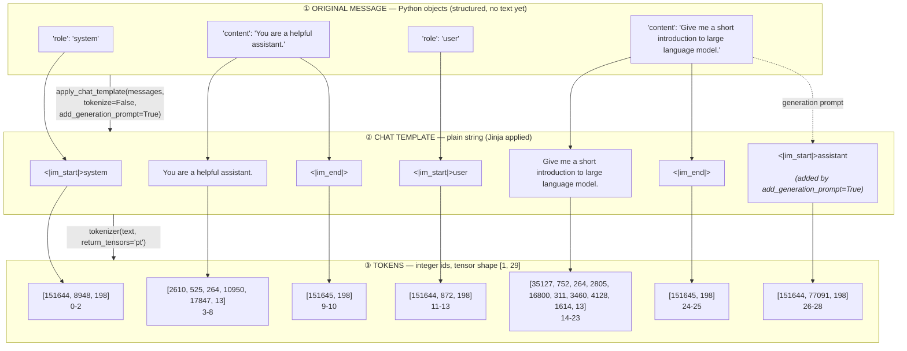

# Chat Template Flow

Model: `Qwen/Qwen2.5-3B-Instruct`
Source: `main.ipynb`

Relationship between the **original message**, the **chat template** output, and the **tokens**.

## 1. Layer structure (message → text → token ids)



## 2. Pipeline view (encode → generate → decode)

```mermaid
flowchart LR
  A["messages<br/>(list of dict)"] -->|"tokenizer.apply_chat_template"| B["text<br/>(str)"]
  B -->|"tokenizer(...)"| C["input_ids<br/>(tensor [1,29])"]
  C -->|"model.generate(max_new_tokens=512)"| D["generated_ids<br/>(prompt + completion)"]
  D -->|"output_ids[len(input_ids):]"| E["new tokens only"]
  E -->|"batch_decode(skip_special_tokens=True)"| F["response<br/>(str)"]

  style A fill:#e8f0fe
  style B fill:#e6f4ea
  style C fill:#fce8e6
```



## 3. Notes

| Layer | Type | What owns the format |
|---|---|---|
| ① Original message | `list[dict]` with `role` / `content` | Your code / API schema |
| ② Chat template | `str` | Model's `chat_template` (Jinja) — adds `<\|im_start\|>`, `<\|im_end\|>`, `\n`, and the trailing `assistant` turn |
| ③ Tokens | `Tensor[int]` `[1, 29]` | Tokenizer — special tokens are single ids: `151644` = `<\|im_start\|>`, `151645` = `<\|im_end\|>`, `198` = `\n` |

- `tokenize=False` returns text; `tokenize=True` yields tokens directly (same result).
- Layer ② is not one string per message: each message becomes `im_start + role + "\n" + content + im_end + "\n"`, so ①→②→③ is 1:N:N.
- The final `<|im_start|>assistant\n` (ids 26–28) exists only because of `add_generation_prompt=True`.

## 4. Observed token sequence

```text
 0  151644  <|im_start|>
 1    8948  system
 2     198  \n
 3    2610  You
 4     525  are
 5     264  a
 6   10950  helpful
 7   17847  assistant
 8      13  .
 9  151645  <|im_end|>
10     198  \n
11  151644  <|im_start|>
12     872  user
13     198  \n
14   35127  Give
15     752  me
16     264  a
17    2805  short
18   16800  introduction
19     311  to
20    3460  large
21    4128  language
22    1614  model
23      13  .
24  151645  <|im_end|>
25     198  \n
26  151644  <|im_start|>
27   77091  assistant
28     198  \n
```
