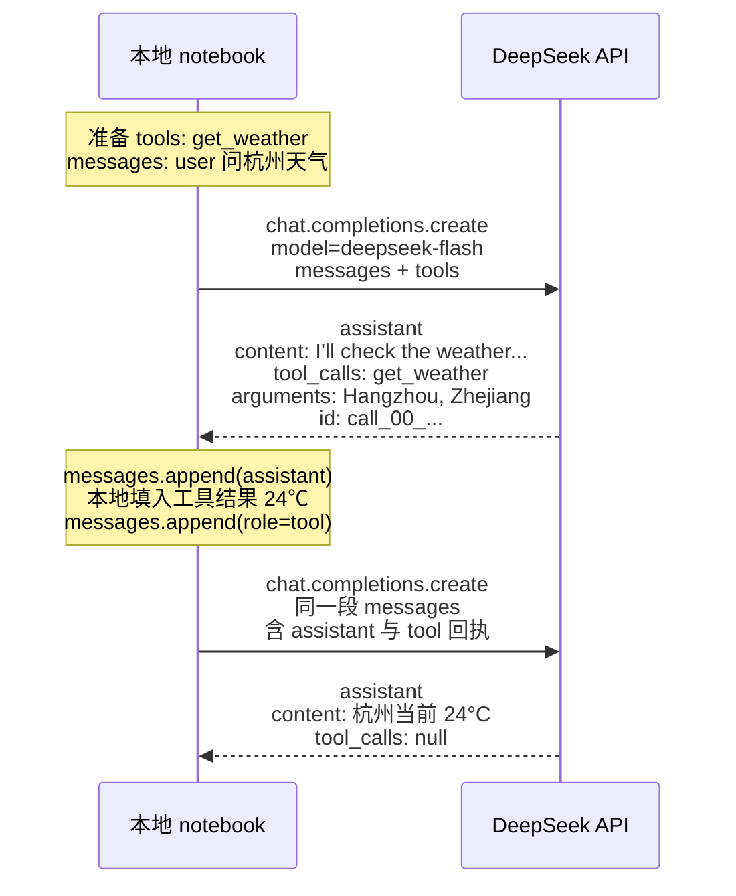

# Local notebook and DeepSeek interaction

The notebook makes two requests. The weather result `24℃` is filled in locally; no real weather API is called.

The first round only decides to call `get_weather` and returns a `tool_call_id`. After the local side appends `24℃` under that same id, the second round writes the final answer.
