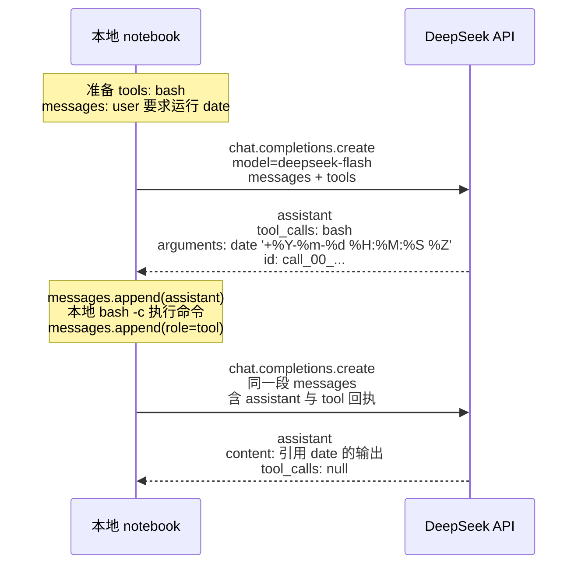

# Local notebook and DeepSeek interaction

The notebook asks for the current date. DeepSeek only returns a `bash` tool call. The command runs locally with `bash -c`, then the stdout goes back as a `role: tool` message.

第一轮只决定调用 `bash` 并返回 `tool_call_id`。本地把命令输出填到同一个 id 下面之后，下一轮才写最终回答。
